# AI PlayGrounds — Roadmap de desarrollo

**Etapa 1 · planificación v1.0 · 05/11/2026 · PROPUESTA PARA A1.**

Fuente técnica: [technical-architecture.md](technical-architecture.md). Contrato editorial: [Content Handoff](content-handoff.md) + E1/E2 allí enlazados. Este roadmap no autoriza empezar la aplicación o desplegar durante la etapa actual.

## 1. Gobierno, alcance y secuencia

Se proponen **ocho etapas totales, incluida esta arquitectura, y catorce prompts principales P01–P14**. No existía un desglose técnico previo versionado: esta distribución es propuesta ejecutable, no un calendario aprobado o una estimación de días. Las iteraciones de corrección viven en el mismo prompt/etapa, no agregan prompts principales ni nuevas aprobaciones.

Solo tres aprobaciones humanas planificadas:

| Gate | Momento | Autoriza | No autoriza |
| --- | --- | --- | --- |
| **A1 · Arquitectura técnica** | Cierre de etapa 1/P01 | Baseline técnico y roadmap; iniciar setup/implementación local; resolver cf o excepción Wrangler | Publicación, nuevos servicios pagos o exposición de datos retenidos |
| **A2 · Dirección visual implementada** | Cierre de etapa 3/P05 | Expandir diseño ya probado al resto del sitio | Cambiar copy aprobado, inventar activos/inventario o activar captación sin condiciones |
| **A3 · Publicación final** | Etapa 8/P14, antes de producción | Desplegar artefacto/SHA revisado, dominio y alcance explícitos; operación inicial | Publicar después otro SHA no revisado, reactivar datos sin permisos o contratar planes no autorizados |

No hay gates humanos adicionales al cerrar contenido, formulario, SEO, QA o cada PR. Revisión de código, recopilación de permisos y pruebas operativas son controles continuos, no una nueva aprobación de producto. Configuración remota de previews/servicios se realiza únicamente en su etapa autorizada, con objetivo/alcance conocidos; no se infiere autorización desde el mero nombre de un prompt. Si faltan datos, se mantiene la unidad deshabilitada y se continúa el resto.

```mermaid
flowchart LR
  E1["1 Arquitectura / P01"] --> A1["A1"]
  A1 --> E2["2 Base técnica / P02-P03"]
  E2 --> E3["3 Dirección visual / P04-P05"]
  E3 --> A2["A2"]
  A2 --> E4["4 Contenido / P06-P07"]
  E4 --> E5["5 Páginas / P08-P09"]
  E5 --> E6["6 Integraciones / P10-P11"]
  E6 --> E7["7 QA / P12-P13"]
  E7 --> E8["8 Release / P14"]
  E8 --> A3["A3"]
  A3 --> P["Producción y smoke"]
```

## 2. Vista general de las ocho etapas

| Etapa / prompts | Objetivo y dependencias | Alcance / entregables | Validación / finalización |
| --- | --- | --- | --- |
| **1 · Arquitectura — P01** | Auditar y fijar decisiones; depende de repo real y fuentes aprobadas | Dos documentos; especificación sin implementación, audit/ADR/riesgos/roadmap | Checks documentales, fuentes preservadas y commit; termina para ejecución al obtener A1 |
| **2 · Base técnica — P02–P03** | Aplicación mínima y camino reproducible; depende de A1 y elección CLI | Setup tipado, target Worker, lockfiles/checks, CI y definición de previews seguros | Build/checks locales + empaquetado; CI sin secretos; preview protegido solo si autorizado y disponible; sin producción |
| **3 · Dirección visual — P04–P05** | Probar identidad web antes de extenderla; depende de base y assets permitidos | Tokens/Starwind, layout y muestra implementada con copy real | Responsive/a11y/perf y capturas; A2 sobre dirección implementada, no mockup ficticio |
| **4 · Contenido — P06–P07** | Preparar publicación controlada; depende de contrato técnico/editorial, no de inventario nuevo | Siete modelos, extracción pública explícita, selecciones/relaciones y validadores | 8 páginas/52 IDs, hashes/meta/copy, Bootcamp único, cero fichas demo; permiso ausente retiene dato |
| **5 · Website — P08–P09** | Completar composición institucional y plantillas; depende de A2/modelos | Ocho rutas reales y dos tipos condicionales, navegación/contexto/vacíos/404 | Matriz handoff cubierta, enlaces/anclas/estados correctos; sin inventar corpus ni activar captación |
| **6 · Integraciones — P10–P11** | Contacto y medición seguros; depende de páginas, contrato API y datos legales/operativos para activación | EM6 único, Worker/Turnstile/Brevo, consentimiento, GA4/Clarity/Search Console preparados | Mocks/unit/E2E; live controlado solo autorizado, sin falsos éxitos; pendientes aislados no frenan resto |
| **7 · QA integral — P12–P13** | Cerrar regresiones y riesgos; depende de sitio integrado | Evidencia automatizada/manual, correcciones, auditoría output, seguridad/perf/runbook | Criterios de arquitectura §14 y handoff §13 satisfechos o funciones retenidas explícitas; sin nuevo gate |
| **8 · Release — P14** | Artefacto reproducible y publicación controlada; depende de QA y datos de destino | Release candidate con SHA, manifiesto de funciones, A3; deploy y smoke solo después | Checks del artefacto, rollback disponible, aprobación ligada a SHA; cierre con observación y pendientes reales |

## 3. Contrato común de cada prompt futuro

Antes de trabajar: comprobar rama/estado Git y conservar cambios ajenos; leer solo las fuentes pertinentes y skills instalados. No crear otra rama en esta etapa. Las etapas siguientes respetarán el flujo de ramas/PR autorizado por el responsable, sin crear infra ni publicar por inferencia. No instalar skills nuevos; `web-content-design` se conserva, no se reinicia Research/E1/E2.

Cada prompt entrega: cambios acotados, comandos realmente ejecutados y resultados, entorno/SHA, diff revisado, pendientes por unidad y evidencia de no exponer material interno. No decir «validado» por una prueba no realizada. Sin cambios editoriales silenciosos, secretos en Git/chat, servicios pagos o demos convertidos en registros. Una incompatibilidad ordinaria de API se resuelve dentro del stack; un cambio material se documenta y no se implementa sin autorización pertinente.

Los comandos concretos se fijan en los manifiestos durante P02/P03; los nombres de scripts de arquitectura son contratos propuestos, no scripts ya disponibles. Las pruebas de la app no se ejecutan en P01.

## 4. Desglose de los catorce prompts principales

### P01 — Auditoría y especificación técnica · Etapa 1

- **Objetivo:** definir un baseline ejecutable sin implementar el website.
- **Dependencias:** rama `feat/website-design-system`, E1 v2.2/E2 v2.1/handoff, marca y documentación técnica verificables.
- **Alcance:** auditoría real; alternativas, modelos/52 IDs, tokens, formulario, CLI, seguridad, previews, QA y riesgos. No Astro, dependencias de aplicación, credenciales, provisioning ni deploy.
- **Entregables:** `technical-architecture.md` y `development-roadmap.md`, commit documental en rama activa.
- **Validaciones:** coherencia de enlaces/estructura/tablas, matriz de rutas/IDs, hashes y diff de fuentes, scan de secretos nuevos, estado Git.
- **Criterio de finalización:** ambos documentos revisables y commit confirmado; detenerse. **A1 pendiente** hasta decisión humana expresa; no ejecutar P02 automáticamente.

### P02 — Inicialización y compatibilidad local · Etapa 2

- **Objetivo:** obtener el mínimo Astro SSG + Worker tipado empaquetable.
- **Dependencias:** A1 con elección de CLI resuelta. Toolchain Node compatible; metadatos candidatos en arquitectura §15.1 no sustituyen build.
- **Alcance:** setup Astro estático en raíz, strict TS, Tailwind v4, Starwind Astro gratuito y Lucide; target Worker aislado con cf/builder según §4.3, sin SSR/React/DB. Fijar versiones exactas/lockfiles y reglas ignore. No autoconfiguración cf sobre raíz Astro ni red live.
- **Entregables:** manifiestos/scripts/configs mínimos, ignore/env example inocuo, build estático mínimo sin contenido ficticio, Worker local sin captación activa, registro de compatibilidad efectiva.
- **Validaciones:** engines/peers; `npm ci`, Astro Check/TS strict/build y runtime local; generar tipos; assets ../dist y ruta API; packaging dry-run sin red/credenciales. Si cf beta requiere forma distinta de build config, resolver con documentación de versión; no cambiar stack ni añadir adaptador de manera oculta.
- **Criterio de finalización:** reproducción desde instalación limpia, ningún secreto/proveedor real necesario y configuración fuente única. Si empaquetado no funciona, registrar bloqueo reproducible antes de extender UI.

### P03 — CI, checks y estrategia preview · Etapa 2

- **Objetivo:** hacer verificable cada PR sin confundir preview con producción.
- **Dependencias:** P02; disponibilidad de GitHub/Cloudflare y controles Access solo para ejecución remota autorizada.
- **Alcance:** scripts explícitos de lint/format/check/content/build/output y workflows checks/preview/cleanup. Selección segura de código confiable, no secretos para forks ni `pull_request_target` ejecutando head ajeno. Previews efímeros por PR, contexto separado, mock mail/analytics off y noindex.
- **Entregables:** CI versionada, documentación de entornos/bindings/Secret names, lifecycle y contrato de protección main; definición de Access/no bypass antes de preview remoto. No producción ni staging permanente.
- **Validaciones:** checks sin red a proveedores; pin Actions, permisos mínimos, concurrencia y cleanup por ID; output no contiene fuentes internas. Si se autoriza/configura preview, HTTP/headers/Access efectivos y sin ruta alternativa pública.
- **Criterio de finalización:** pipeline local/PR reproducible; definición de despliegue segura. Sin destino/protección autorizados, resultado local y workflow remoto deshabilitado con dependencia explícita; no fingir URL preview creada. Esta limitación no bloquea P04 local.

### P04 — Tokens, tipografía y base Starwind · Etapa 3

- **Objetivo:** implementar principios visuales como aplicación web de la marca.
- **Dependencias:** P02–P03; PDF/brand-spec y permisos de assets incorporados. P06 no es requisito para probar tokens con fragmentos E2 extraídos explícitamente.
- **Alcance:** capas de tokens canónicos/extensión propuesta/aliases, Tailwind CSS-first, fuentes locales licenciadas, contenedores/escala, themes por sección y estados de componentes Starwind estrictamente necesarios. No biblioteca propia ni componente por ID.
- **Entregables:** tokens/global CSS, fuentes/maestros permitidos, base layout y controles nativos/Starwind; documentación breve de semántica y procedencia.
- **Validaciones:** contraste real claro/oscuro, keyboard/focus, forced colors, reduced motion, font load y bundle; comprobar API de fuente instalada, sin props inventadas.
- **Criterio de finalización:** base visual coherente y usable; no glow/serif ajenos, acentos ilegibles o assets copiados del deck sin permiso. Sin gate humano adicional; seguir a P05.

### P05 — Dirección visual implementada y revisión · Etapa 3

- **Objetivo:** comprobar la composición real antes de multiplicarla a todas las páginas.
- **Dependencias:** P04 y copy público aprobado pertinente; permisos de material mostrado.
- **Alcance:** muestra de Inicio con secciones reales y navegación, más un fragmento representativo de comparación/datos de Formación o Empresas si hace falta para probar densidad/controles. No reescritura E2, personas retenidas, fichas ficticias ni nuevas rutas públicas de demo.
- **Entregables:** composición implementada, capturas móviles/escritorio, inventario corto de decisiones visuales y límites de material.
- **Validaciones:** 320/360/768/1440, zoom, teclado/foco, H1 y copy literal, presupuestos de bundle, claro/oscuro por intención y ausencia de clipping. ~75/25 global no cuota por página.
- **Criterio de finalización:** evidencia funcional suficiente para **A2 · Dirección visual implementada**; iterar aquí hasta su aprobación. No extender como diseño definitivo al resto antes de A2.

### P06 — Schemas, loaders e identidad · Etapa 4

- **Objetivo:** construir la capa de datos tipada y controles de elegibilidad.
- **Dependencias:** A1, P02 y contrato handoff §§5–6; el orden principal sitúa esta etapa después de A2.
- **Alcance:** siete modelos lógicos Content Layer, loaders acotados, pages y fragmentos Markdown específicos, IDs/slug estables, fechas de precisión variable, schemas de borrador/elegible y proyecciones allowlist. Tests fuera de contenido público.
- **Entregables:** `src/content.config.ts`, utilidades mínimas de consulta/validación, mapa de rutas/IDs y tests de completitud/estado/permisos/referencias.
- **Validaciones:** exactitud de ocho pages/52 IDs, IDs PER sin normalización accidental, schema inválido falla, vacío válido, relaciones inexistentes rechazadas, ninguna ruta de entidad sin elegibilidad.
- **Criterio de finalización:** modelos permiten estado real sin inventarlo; no motor universal, lectura de `content/internal/` en loader, catálogo de muestra o serialización completa al cliente.

### P07 — Traslado público y datos compartidos · Etapa 4

- **Objetivo:** preparar contenido real reutilizable sin notas internas ni autorización inferida.
- **Dependencias:** P06; E2/handoff vigentes y fuentes pertinentes disponibles.
- **Alcance:** extracción manual/expresa del copy público y metadatos, cuatro Luma/hitos documentados, Bootcamp único histórico en programs, verticales/líneas compartidas, selecciones por página. Preparar 15 registros lógicos de personas retenidos donde falte permiso; no recopilar bios/fotos por iniciativa técnica. Iniciativas/productos/research vacíos.
- **Entregables:** contenido y datos versionados de build, matriz de localizadores E2 → sección/entidad, estado/alcance de autorización sin pruebas privadas en Git público.
- **Validaciones:** copy/H1/meta literal y condiciones cerca del claim, fechas/roles/cifras sin Went, cuatro proyecciones del mismo Bootcamp, PER02 único, no URLs privadas/tokens. E1/E2/handoff sin cambios.
- **Criterio de finalización:** fuentes públicas preparadas y pendientes retenidos explícitos; no activar formularios, WhatsApp, registros o permisos por el mero traslado. No gate editorial nuevo.

### P08 — Ocho páginas institucionales · Etapa 5

- **Objetivo:** completar los recorridos y composición del website institucional.
- **Dependencias:** A2, P06–P07, layouts/tokens de P04–P05.
- **Alcance:** Inicio, Formación, Empresas, Comunidad, AI Labs, Productos, Investigación y Equipo. Navegación global, anclas exactas I3/C3/F4/EM5/EM6 y variantes por sección. Completar muestra P05 sin duplicar copy. EM6 informativo/desactivado hasta P10; WhatsApp solo si URL confirmada.
- **Entregables:** ocho rutas SSG y componentes de contenido con reutilización real, sin renderer genérico; responsive y empty states conforme al handoff.
- **Validaciones:** rutas/anclas/orden/heading, contraste/teclado, sin headings/listados condicionales vacíos, sin CTA falsa, sin cursos/servicios/reclutamiento inferidos, datos personales retenidos fuera de HTML.
- **Criterio de finalización:** ocho páginas completas en su **estado institucional permitido**, no ocho catálogos supuestamente poblados; accesos y continuidad institucional operables sin JS.

### P09 — Plantillas condicionales y continuidad SEO · Etapa 5

- **Objetivo:** soportar detalle futuro sin publicar entidades inexistentes.
- **Dependencias:** P06–P08 y reglas P1/P2/P3/P5/P6/P7/P9 y R1/R2/R4/R5/R6/R7.
- **Alcance:** dos plantillas SSG, `getStaticPaths` desde registros elegibles, resúmenes del mismo registro, retornos, 404 real y retiro de rutas. Canonical/metadatos base/sitemap elegible. No filtros operativos sin corpus ni páginas de facetas.
- **Entregables:** `/productos/[slug].astro` y `/investigacion/[slug].astro`, funciones de URL/SEO/proyección compartidas y tests positivos de contrato/negativos de publicación. Sin registros ficticios.
- **Validaciones:** corpus cero → cero fichas y enlaces/sitemap/JSON-LD de instancias; 404 no soft-404; metadatos/retornos correctos para registro real cuando exista. Verificación visual de primera ficha pública queda ligada a entrada real y permisos, no datos inventados para QA.
- **Criterio de finalización:** ambos tipos preparados con condiciones completas; ausencia de inventario no es fallo del sitio ni excusa para generar demos.

### P10 — Contacto Empresas y protección · Etapa 6

- **Objetivo:** conectar un solo formulario a un flujo seguro y comprobable.
- **Dependencias:** P08, runtime/schema Worker, política real/URL/base legal/versionado y destinatario/remitente/Turnstile/Brevo para habilitación live. Sin datos, implementar y probar con mocks, flag disabled.
- **Alcance:** tres CTA/dos tipos visibles editables, campos/mensajes E2, validación cliente/servidor, origen/tamaño/rate limit, Siteverify/action/hostname y token lifecycle, Brevo fetch esperado/idempotencia acotada, estados accesibles sin PII almacenada en navegador. No CRM, acuse al visitante, colas, DB o servicio extra.
- **Entregables:** EM6 y `POST /api/contact`, provider adapters mínimos, env contract/flags, pruebas y registro de aceptación/error/deduplicación.
- **Validaciones:** dobles clics/concurrencia, timeout/duplicado sin confirmación no éxito, retry mismo UUID/token nuevo, sandbox no entrega; prueba real de canal/idempotencia solo autorizada a buzón controlado. Política y permisos reales antes de captación pública.
- **Criterio de finalización:** contrato funcional verificado por mocks y runtime; si no hubo recepción real o privacidad completa, live permanece deshabilitado, no se presenta como operativo. La decisión de publicar con función retenida se concentra en A3, no una aprobación extra de etapa.

### P11 — Consentimiento, analítica y descubrimiento · Etapa 6

- **Objetivo:** preparar medición mínima y SEO técnico sin tracking involuntario.
- **Dependencias:** P08–P10, dominio y datos legales para producción, IDs/propiedades reales si se activan.
- **Alcance:** preferencias versionadas con rechazo inicial/retirada, GA4 básico directo, Clarity opt-in fuera de Empresas, eventos allowlist sin PII, sitemap/robots/canonical, Schema solo candidato sustentado. Search Console DNS se documenta/prepara, verificación final después de dominio/publicación autorizados.
- **Entregables:** controlador consentimiento/analytics, metadatos técnicos, tests de red y matriz de integraciones por contexto.
- **Validaciones:** ninguna petición/tag/preconnect antes de consentimiento o tras retirada/categoría deshabilitada; no Clarity en Empresas; IDs ausentes desactivan, preview noindex/sin analítica, JSON-LD solo de contenido visible real; sin inventar propiedad/afiliación.
- **Criterio de finalización:** sitio utilizable sin tracking y sin consentimiento de analítica; cada integración activa tiene configuración/condiciones comprobadas o se declara retenida, no sustituida por otro proveedor.

### P12 — QA funcional, editorial y accesibilidad · Etapa 7

- **Objetivo:** comprobar recorridos y fidelidad del conjunto.
- **Dependencias:** P08–P11 y matriz handoff §13.
- **Alcance:** Playwright/axe, navegación/rutas/anclas, responsive/zoom/keyboard/lector de pantalla, revisión de copy y permisos, corpus vacío/personas parciales/formulario/consentimiento y errores. Corregir código sin alterar E1/E2/handoff.
- **Entregables:** matriz de QA automática/manual con evidencia reproducible, correcciones y lista de limitaciones por función/entorno.
- **Validaciones:** Chromium por PR, Firefox/WebKit en release, 320/360/768/1440, 200/400 % zoom, WCAG 2.2 AA con revisión humana; datos sensibles ausentes de screenshots/traces/artifacts.
- **Criterio de finalización:** sin defectos críticos/altos abiertos de funcionalidad, exposición o acceso; incidencias residuales no se esconden tras scores. No aprobación humana de producto adicional.

### P13 — Rendimiento, seguridad y preparación operativa · Etapa 7

- **Objetivo:** asegurar una salida rápida, mínima y mantenible.
- **Dependencias:** P12 y build productivo con configuración real no secreta disponible; dominio/canales para pruebas remotas solo autorizadas.
- **Alcance:** presupuestos JS/CSS/fonts/imágenes, Lighthouse, output allowlist/secrets, CSP/headers/404/cache, protección API, dependencias/lockfiles, cuotas/observabilidad y runbook de incidentes/rollback. Monitor GitHub/Cloudflare/Brevo proporcional sin nuevo SaaS.
- **Entregables:** informe de mediciones/seguridad con entorno/limitaciones, correcciones y runbook con responsables/alertas y alcance del rollback.
- **Validaciones:** mediana de tres Lighthouse, presets móvil y terceros consentidos/no consentidos, empaquetado sin autoconfiguración, ausencia de PII en logs, headers efectivos, Access/no bypass, flags fail-closed y capacidades Free reales. Ensayo rollback fuera de producción.
- **Criterio de finalización:** criterios arquitectura §14 satisfechos; riesgos que bloquean funcionalidades se resuelven o esas funcionalidades quedan deshabilitadas en candidato. No SLA ni CWV de campo declarado sin tráfico real.

### P14 — Candidato, autorización final y publicación · Etapa 8

- **Objetivo:** publicar exactamente lo revisado y cerrar con evidencia operativa.
- **Dependencias:** P13, artefacto de SHA main con checks, dominio/cuenta/recursos autorizados y permisos/canales del alcance que se publicará. A3 necesaria antes de producción.
- **Alcance antes de A3:** crear candidato inmutable/checksum, manifiesto de funciones activas/omitidas, pruebas/release notes y plan de DNS/TLS/WAF/monitor/rollback. Revisar pendientes sin inventar políticas, permisos o canales. Si producción todavía no está autorizada, detener este prompt en el gate.
- **Entregables antes de A3:** paquete de revisión con SHA, dominio, alcance, costes verificados, resultado de QA y pendientes/restricciones, decisión humana **A3 · Publicación final** registrada en Environment production o evidencia equivalente única.
- **Alcance después de A3:** desplegar solo artefacto aprobado, sin rebuild sobre HEAD nuevo; configurar únicamente cambios incluidos en autorización; smoke real HTTP, navegación, errores/headers/consentimiento y captación solo si habilitada. Verificar Search Console/sitemap con propiedad autorizada; monitorizar métricas y recepción operativa. No envíos de carga ni consultas ficticias públicas.
- **Validaciones:** SHA y checksum coinciden, salida no preview, DNS/TLS/host canónico, noindex de preview persiste y producción no hereda bloqueo, no datos retenidos, versión previa identificada; rollback si incidente conforme a runbook sin reexponer datos retirados.
- **Criterio de finalización:** producción del alcance autorizado comprobada, estado de funciones honesto, responsable operativo y rollback disponibles; pendientes y comprobaciones de campo futuras declaradas. Si falta A3/dominio/seguridad esencial, termina con candidato listo y publicación bloqueada, **sin deploy**. No segundo gate de publicación ni merge/deploy en P01.

## 5. Dependencias que no deben paralizar todo el proyecto

| Ausencia | Continuar con | Retener hasta resolver |
| --- | --- | --- |
| URL WhatsApp | Comunidad institucional e historia | Enlace de acceso y copy que afirma invitación operativa |
| Política/buzón/servicios | UI privada, mocks y validación de contrato | Captación/éxito live y sus CTA operativos |
| Permisos/fotos/bios | Estructura colectiva y datos autorizados | Solo campo/persona/material afectado; nunca rellenar con IA |
| Inventarios Labs/Productos/Research | Explicaciones, schemas, plantillas y pruebas negativas | Listados/filtros/fichas/Schema de instancias |
| Dominio/Access/tokens de deploy | Desarrollo local y artefactos sanitizados | Preview remoto inseguro y producción |
| IDs analítica/propiedad GSC | Consentimiento opt-in y SEO local validable | Tracking/verificación real; no IDs simulados |

Las condiciones institucionales/legales deben constar en el paquete A3; no se transforman automáticamente en pendientes aceptados. El responsable puede autorizar un lanzamiento institucional con funciones retenidas si no aparentan estar disponibles y se conservan las reglas del handoff. No se puede aceptar exposición de secretos/PII no autorizada como limitación menor.

## 6. Estado de salida de Etapa 1

La entrega actual completa **P01 documental**. P02–P14 son trabajo futuro no ejecutado. No hay aplicación, preview, envío, monitor ni infraestructura configurados por esta tarea. El siguiente paso es revisar y aprobar **A1** (incluida elección CLI); después puede comenzar etapa 2 local. Etapa 1 se detiene aquí, sin merge, push o despliegue.
