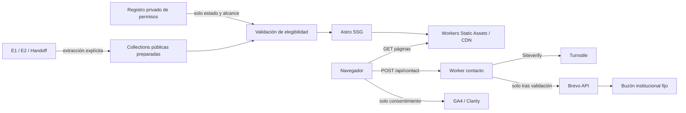
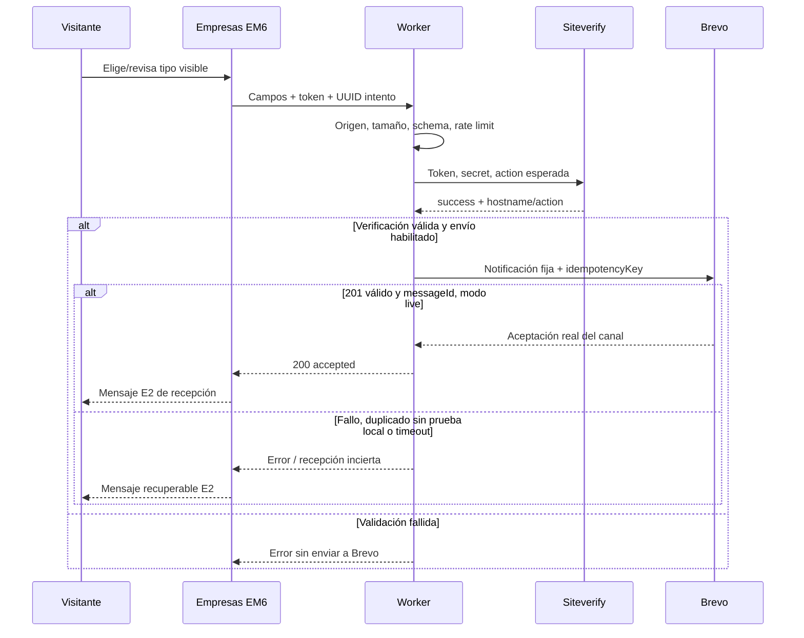
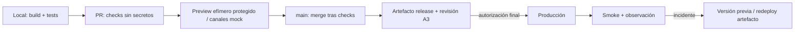

# AI PlayGrounds — Arquitectura técnica del website

**Etapa 1 · especificación v1.0 · corte: 05/11/2026 (Perú).**
**Estado A1: APROBADA el 05/11/2026.** Se autoriza implementación local con Wrangler 4 y `wrangler.jsonc`; P02 no autoriza despliegues, servicios remotos, DNS ni producción. Condiciones editoriales y permisos siguen siendo independientes.

Documento complementario: [roadmap de ocho etapas y catorce prompts](development-roadmap.md). No reemplaza [Content Handoff](content-handoff.md), E1 ni E2.

## 1. Resumen ejecutivo

Recomendación: **Astro estático y un único Worker pequeño de contacto, dentro del mismo despliegue Workers Static Assets**. Ocho páginas institucionales prerenderizadas y dos plantillas condicionales de detalle; cero fichas mientras no existan registros elegibles. HTML/CSS primero, TypeScript estricto y JavaScript localizado, sin React inicialmente. Tailwind v4, Starwind Astro y Lucide sostienen la implementación, no un framework propio de secciones.

Contenido público preparado explícitamente desde E2 en Content Collections de build. Las fuentes editoriales completas, archivos históricos, pruebas de autorización y herramientas quedan fuera de los assets. No CMS, base de datos, KV, Durable Objects, colas, API de catálogo ni búsqueda remota.

Empresas tendrá un formulario y un endpoint; Turnstile se valida en servidor y Brevo recibe una notificación a un destinatario institucional fijo. Idempotencia acotada en Brevo, no promesa de entrega exactamente una vez. Sin política de privacidad y recepción verificadas no se activa la captación.

Dirección visual web: superficies mayormente claras (~75 %) y cortes oscuros (~25 %) como orientación global, no cuota por página. La marca canónica sigue siendo predominantemente oscura; la extensión light es una propuesta de aplicación, no una modificación del manual.

CI valida cada PR sin secretos. Previews efímeros, protegidos y sin datos/canales productivos; producción solo después de la autorización final. Se planifican únicamente **A1 arquitectura, A2 dirección visual implementada y A3 publicación final**. Los permisos y datos que se recopilen durante el trabajo no se convierten en nuevas puertas de aprobación de etapas.

## 2. Estado real del repositorio

Auditoría de solo lectura realizada antes de escribir estos dos entregables:

| Comprobación | Evidencia observada |
| --- | --- |
| Repositorio y rama | `AIPlayGrounds-org/app-aiplaygrounds`, `feat/website-design-system`; HEAD inicial `bdd78cb` (`chore: install website development skills`) |
| Estado inicial | `git status --short` vacío; sin cambios locales ajenos que preservar |
| Aplicación | No hay `src/`, `public/`, `package.json` de aplicación, lockfile de aplicación, Astro/Tailwind/Starwind config, tests de aplicación ni workflows GitHub Actions versionados |
| Cloudflare | No `wrangler.jsonc`, `wrangler.json`, `wrangler.toml` ni `cloudflare.config.ts`; no configuración previa que migrar o considerar desplegada |
| Fuentes | E1 v2.2, E2 v2.1 y `docs/implementation/content-handoff.md` presentes; handoff aprobado para transición, no lanzamiento |
| Dependencias locales de herramientas | `.opencode/package.json`: `@opencode-ai/plugin` 1.18.33; `content/.opencode/package.json`: 1.18.34; sus lockfiles/node_modules no acreditan dependencias del website ni se reutilizarán |
| Skills | Nueve skills en `.agents/skills/`, inventariados en `skills-lock.json`; `web-content-design` conservado en `.opencode/skills/web-content-design/` |
| Documentación actual | `content/entregables-cliente/`, `content/internal/`, `content/archive/`; README raíz mínimo; `LICENSE` existente, sin sustituirlo |
| Ignorados | `.env*` salvo `.env.example`, node_modules y dist ya ignorados; todavía no regla específica para `.dev.vars`, `.astro`, `.wrangler`, `.cloudflare` y artefactos Playwright: añadirla durante setup |
| Visibilidad | GitHub API informa ambos repositorios consultados como públicos; no se cambió visibilidad |
| Protección de main | Endpoint de protección de rama responde `404 Branch not protected`; no se consultaron rulesets, por lo que no se afirma ausencia de toda política equivalente |

**Material potencialmente interno/sensible:** `content/internal/` y `content/archive/` incluyen brief, decisiones, feedback, evidencia y datos personales; E2 también incluye datos retenidos e instrucciones no publicables. `.opencode/` contiene herramientas y evaluaciones; hay un `__pycache__` versionado preexistente. No eliminar ni redistribuir estos archivos. El hecho de estar en un repositorio público no concede permiso de publicación en el website; tampoco puede el build garantizar confidencialidad del historial Git. El propietario deberá evaluar por separado esa exposición ya existente. Esta tarea no hace saneamiento de historial ni copia datos privados adicionales.

Se inspeccionaron rutas/manifiestos/archivos versionados y el diff nuevo; no se leyó ni imprimió un almacén de credenciales. No se auditó ninguna cuenta Cloudflare/Brevo/Google/Microsoft ni se solicitó acceso.

### 2.1 Uso de skills y límites

Se leyeron y aplicaron `astro-best-practices` (SSG/islas), `content-collection` (Content Layer y relaciones), `starwind-ui` (fuente editable, tokens, HTML nativo), `workers-best-practices` (runtime, secretos, observabilidad), `wrangler` (configuración y previews), `turnstile-spin` (contrato Siteverify), `playwright-cli` (inspección de referencias), `frontend-design` (dirección visual) y `web-design-guidelines` (criterios de QA). Se consultó también `cf-cli`, ya disponible en el entorno, para resolver la prioridad de CLI. No se instalaron skills. Se conserva el skill editorial sin activar su flujo: no se hizo nueva estrategia ni redacción editorial.

El wizard operativo de Turnstile no se ejecuta: no existe backend aún y el encargo prohíbe provisioning, credenciales e implementación. Las reglas genéricas de diseño/copy de skills no prevalecen sobre E2, por ejemplo en mayúsculas, mensajes, empty states o campos obligatorios.

## 3. Fuentes de verdad y prioridades

### 3.1 Contrato local

| Fuente | Prioridad y uso |
| --- | --- |
| Encargo de Etapa 1 | Stack, alcance técnico, límites y tres aprobaciones; Brevo/Turnstile/analítica previstos, detalles por concretar |
| [E1](../../content/entregables-cliente/01-direccion-contenido-estructura/direccion-contenido-estructura-web.md) | Arquitectura editorial: ocho páginas, dos tipos, orden, voz y recorridos |
| [E2](../../content/entregables-cliente/02-contenido-web/contenido-web.md) | Copy público literal, H1/metadatos y modelos; prevalecen sus precisiones posteriores conforme al handoff §1.3 |
| [Content Handoff](content-handoff.md) | Contrato de transición: §§2–6 rutas/52 IDs/modelos; §§7–10 canales/personas; §§11–13 SEO y aceptación |
| Esta arquitectura | Organización técnica propuesta; nunca habilita por sí sola una unidad editorial o personal retenida |
| Skills/documentación oficial | APIs y restricciones técnicas; verificar contra versiones fijadas, no copiar ejemplos sin revisión |

SHA-256 observados: E1 `2e5f0c800590a31e34392a263257b456b3aaa250bc8af4f9436cc84ff833ee3c`; E2 `bd785bf6a27f09731833f6e7a65d7bfc0b04932c8f1302310b1a383c71e0d947`. El handoff tiene referencias suficientes para acudir a documentación interna solo ante una duda material; no se necesita reabrir todo Research.

**Estados usados:** HECHO = comprobado en fuente; REQUISITO = encargo/handoff; PROPUESTA = elección técnica de esta entrega; PENDIENTE = valor/permiso/prueba no disponible. Todas las carpetas, schemas, componentes, variables, límites y comandos futuros siguientes son PROPUESTA salvo requisitos expresamente atribuidos. No son archivos o servicios ya existentes.

### 3.2 Marca y referencias inspeccionadas

Repositorio de marca en commit **`586bbb38923895ee5cf5c7366f85a48f642b0c81`**:

- [Manual V3 Núcleo, octubre 2026](https://github.com/edhutech/ppt-ai/blob/586bbb38923895ee5cf5c7366f85a48f642b0c81/branding/branding-base.pdf): fuente canónica, texto de sus 16 páginas inspeccionado mediante extracción PDF. No se hizo una auditoría gráfica página por página.
- [brand-spec.md](https://github.com/edhutech/ppt-ai/blob/586bbb38923895ee5cf5c7366f85a48f642b0c81/branding/brand-spec.md): distingue C canónico, D derivado para slides y P light propuesto; PDF prevalece sobre la transcripción.
- [output/deck.html](https://github.com/edhutech/ppt-ai/blob/586bbb38923895ee5cf5c7366f85a48f642b0c81/output/deck.html): HTML/CSS inspeccionados, lienzo fijo 1152×648 escalado, alternancia de negro y neutros cálidos, fuentes de marca. No reutilizar layout de presentación, escalado de texto, navegación por slides, fuentes embebidas o registros de ejemplo. No es fuente editorial del website ni asset maestro del logo.

Referencias web: consulta textual y capturas del primer viewport **1440×1000 en Chromium**, 05/11/2026 Perú (artefactos UTC del 06/11). Capturas/snapshots solo en `/tmp/opencode/aip-architecture/`, no en assets del repositorio.

| Referencia | Observación directa limitada | Inspiración aplicable / no trasladar |
| --- | --- | --- |
| [Anthropic](https://www.anthropic.com/) | Fondo claro de apariencia cálida, statement grande alineado a izquierda, navegación compacta y mosaico de imágenes debajo en el viewport observado | Jerarquía editorial/espacio/claridad; no copiar serif, mosaico, cápsulas, copy o imágenes |
| [Y Combinator](https://www.ycombinator.com/) | Amplio espacio negativo y titular serif centrado, marca naranja y navegación arriba | Prioridad del mensaje; no promesas de inversión, testimonios ni tipografía ajena |
| [Silicon Valley Fellowship](https://www.siliconvalleyfellowship.com/) | Apertura en dos columnas, fotografía real, superficies claras, acentos azules y franja de datos/logos | Ritmo y separación; no copiar azules, claims, retratos, carruseles o oferta |
| [yeiyei.me](https://yeiyei.me/) | Gran saludo sans a izquierda y retrato a derecha; captura muestra saludo parcial en ese instante; texto recuperado incluye navegación por anclas e historial | Economía de navegación y contraste de escala; no imitar efecto de escritura ni importar biografía/relaciones como hechos de AI PlayGrounds |

Limitaciones: primer intento del navegador falló por ausencia de Chrome del sistema; se usó Chromium ya instalado, sin descargar dependencias. Hubo errores de recursos/terceros en algunas referencias; no se deduce su causa ni se certifica funcionamiento completo. No se inspeccionaron exhaustivamente móvil, scroll, hover, accesibilidad ni animaciones de esos sitios. Colores descritos no son HEX muestreados. Las observaciones de capturas antiguas en `brand-spec.md` no se presentan como observaciones actuales propias.

### 3.3 Evidencia técnica externa

Documentación consultada en este corte; las URLs oficiales siguientes respaldan las decisiones por sección:

| Clave | Fuente / alcance |
| --- | --- |
| T1 | [Astro en Cloudflare](https://docs.astro.build/en/guides/deploy/cloudflare/): SSG no requiere adaptador; SSR sí |
| T2 | [Astro Content Collections](https://docs.astro.build/en/guides/content-collections/), skill local Content Layer: loaders de build, referencias, `render` y `getStaticPaths` |
| T3 | [HTML handling](https://developers.cloudflare.com/workers/static-assets/routing/advanced/html-handling/): barras finales y redirects; [Workers pricing](https://developers.cloudflare.com/workers/platform/pricing/): assets y cuotas |
| T4 | [Previews vs Version URLs](https://developers.cloudflare.com/workers/previews/compare-workflows/) y [recursos/aislamiento](https://developers.cloudflare.com/workers/previews/resources/): elección y bindings compartidos frente a aislados; skill Wrangler requiere 4.135+ para Previews |
| T5 | [Configuración Wrangler](https://developers.cloudflare.com/workers/wrangler/configuration/) y [routing de assets/Worker](https://developers.cloudflare.com/workers/static-assets/routing/worker-script/): configuración única y orden de ejecución |
| T6 | [Siteverify](https://developers.cloudflare.com/turnstile/get-started/server-side-validation/): 300 s, un uso, hostname/action, idempotencia de validación |
| T7 | [Brevo envío](https://developers.brevo.com/reference/send-transac-email.md), [idempotencia](https://developers.brevo.com/docs/heterogenous-versions-batch-emails.md), [sandbox](https://developers.brevo.com/docs/using-sandbox-mode.md): respuesta, deduplicación y pruebas sin entrega |
| T8 | [Rate Limiting binding](https://developers.cloudflare.com/workers/runtime-apis/bindings/rate-limit/): límites aproximados por ubicación, no contador global estricto |
| T9 | [Google Consent Mode](https://developers.google.com/tag-platform/security/guides/consent), [Clarity consentimiento](https://learn.microsoft.com/en-us/clarity/setup-and-installation/consent-management): carga y retirada de consentimiento |
| T10 | [Web Interface Guidelines](https://raw.githubusercontent.com/vercel-labs/web-interface-guidelines/main/command.md): revisión técnica, subordinada a E2; [WCAG 2.2](https://www.w3.org/TR/WCAG22/) como criterio normativo de QA futuro |
| T11 | [Brevo tarifas](https://www.brevo.com/pricing.md): Free disponible; no demuestra cuota transaccional habilitada para una cuenta concreta |

Las páginas Brevo antiguas probadas (`your-first-email` e idempotency con otros nombres) devolvieron 404; se resolvieron desde su `llms.txt` a T7. No fundamentar decisiones en esas URLs fallidas. Límites comerciales, documentación mutable y APIs exactas se revalidan al fijar el lockfile y antes del lanzamiento.

## 4. Arquitectura general recomendada

### 4.1 Separación mínima

1. **Build:** Node ejecuta Astro, valida Markdown/JSON y crea HTML, CSS, imágenes optimizadas y JavaScript mínimo. Nada se consulta a servicios de contenido en runtime.
2. **Entrega:** Workers Static Assets sirve las páginas; no pasar todo el sitio por el Worker de aplicación. CDN/SSL/DNS/WAF se configuran en etapa autorizada.
3. **Runtime:** un `fetch` Worker TypeScript nativo maneja solamente `POST /api/contact` y rechaza métodos/rutas API restantes. No router externo ni servidor Astro.
4. **Terceros:** Worker → Siteverify → Brevo, secuencial y esperado con `await`. Navegador → GA4/Clarity solo tras consentimiento y activación en producción. WhatsApp/Luma son enlaces, no embeds.

### 4.2 Comparación y selección

| Alternativa | Coste/beneficio | Decisión |
| --- | --- | --- |
| SSG + Worker mínimo en un despliegue | HTML gratuito en Static Assets, backend pequeño y aislado por ruta; dos targets TypeScript pero sin adaptador | **Elegida**: la única necesidad de servidor es contacto |
| Astro SSG + endpoint on-demand con `@astrojs/cloudflare` | Un árbol Astro, pero adaptador y runtime de framework para una sola operación; exige verificar salida y bindings | Reserva si aparece una necesidad real de render por petición; no justificada hoy |
| SSR de todo el website | Más invocaciones y superficie operativa sin datos dinámicos propios | Descartada |
| Worker de API separado | Dos despliegues/dominios o service bindings/CORS sin ganancia actual | Descartada; mantener mismo origen |
| Pages / CMS / DB / funciones de otro proveedor | Se aparta del stack y añade mantenimiento | No adoptada |

### 4.3 CLI: decisión A1

**Aprobado 05/11/2026:** Wrangler 4 es el CLI principal; `wrangler.jsonc` en la raíz es la única configuración de recursos Cloudflare. Un solo `package.json` y lockfile; Worker TypeScript en `worker/index.ts`, assets Astro SSG en `dist/`, sin adaptador Cloudflare ni SSR. `wrangler types` genera los tipos y Wrangler ejecuta las pruebas locales y empaquetado dry-run. En P02 no se autoriza despliegue ni configuración remota.

Se evaluó `cf` y su configuración beta en P01; A1 eligió Wrangler por estabilidad y sencillez. La instrucción local `AGENTS.md` que prioriza `cf` para proyectos sin configuración Wrangler tiene una excepción explícita para este proyecto en A1; no se modifican instrucciones globales. No usar `cloudflare.config.ts` ni `wrangler.config.ts` como configuraciones paralelas.

## 5. Diagramas técnicos





## 6. Estructura de carpetas propuesta

Árbol objetivo; P02 implementa solo el subconjunto mínimo de raíz, layout, estilos, Starwind y Worker:

```text
content/                           # Fuentes existentes; nunca directorio de publicación
docs/implementation/
  content-handoff.md
  technical-architecture.md
  development-roadmap.md
src/
  content.config.ts                # Siete collections, loaders de build acotados
  content/
    pages/<pageKey>/<sectionId>.md  # Narrativa, no notas de E2
    activities/*.json
    programs/*.md
    initiatives/*.md
    products/*.md
    research/*.md
    people/*.json
  data/
    pages.json                     # Ocho registros pages y referencias a bloques
    organization.json              # Verticales, líneas, métricas institucionales sustentadas
    channels.json                  # URLs públicas opcionales; sin secretos
  assets/{brand,images}/
  components/
    starwind/                      # Solo fuente de componentes Astro elegidos
    site/                          # Header, Footer, ConsentPreferences, ContactForm
    content/                       # Reusos reales: ActivitySummary, EntitySummary
  layouts/{BaseLayout,DetailLayout}.astro
  lib/{content,routes,seo}.ts
  scripts/{contact,consent,navigation}.ts
  styles/{tokens,global}.css
  pages/
    index.astro
    formacion.astro
    empresas.astro
    comunidad.astro
    ai-labs.astro
    productos/{index,[slug]}.astro
    investigacion/{index,[slug]}.astro
    equipo.astro
public/
  fonts/                           # Solo WOFF2 y licencias autorizadas
  _headers                         # Seguridad de assets; no copiar documentos internos
worker/
  index.ts
  contact/{schema,handler,brevo,turnstile}.ts
scripts/{validate-content,check-output}.ts
tests/{content,worker,e2e}/
.github/workflows/{checks,preview,release,monitor}.yml
astro.config.mjs
tsconfig.json
wrangler.jsonc
starwind.config.json
package.json
package-lock.json
```

No monorepo framework ni workspace manager: scripts raíz usan el Wrangler local y un único manifiesto de aplicación. Config compartida de formulario solo si hay duplicación real; los schemas de servidor no se importan accidentalmente en cliente. No directorio `public/content`, mirror de docs ni descarga automática del repo de marca.

## 7. Arquitectura de contenido

### 7.1 Rutas, IDs y orden fijados para implementación

Adoptar las rutas del handoff, `trailingSlash: 'always'`, salida Astro `build.format: 'directory'`. Ancla HTML = **ID editorial exacto**, sensible a mayúsculas (`#EM6`, no renumeración). Esta concreta la propuesta de anclas del handoff sin cambiar sus IDs.

| Página / plantilla | Ruta | Secuencia exacta |
| --- | --- | --- |
| Inicio | `/` | I1 → I2 → I3 → I4 → I5 → I8 |
| Formación | `/formacion/` | F1 → F3 → F4 → F6 → F5 |
| Empresas | `/empresas/` | EM1 → EM2 → EM3 → EM4 → EM5 → EM6 |
| Comunidad | `/comunidad/` | C1 → C3 → C4 → C6 → C7 |
| AI Labs | `/ai-labs/` | B1 → B2 → B3 → B4 → B5 |
| Productos | `/productos/` | DP1 → DP2 → DP3 → DP4 |
| Investigación | `/investigacion/` | DI1 → DI2 → DI3 → DI4 |
| Equipo | `/equipo/` | E1 → E2 → E3 → E4 |
| Producto, plantilla | `/productos/{slug}/` | P1 → P2 → P3 → P5 → P6 → P7 → P9 |
| Investigación, plantilla | `/investigacion/{slug}/` | R1 → R2 → R4 → R5 → R6 → R7 |

**39 bloques institucionales + 13 de plantillas = 52 IDs**, no 52 componentes ni 52 bloques visibles obligatoriamente. Enlaces contextuales: `/#I3`, `/comunidad/#C3`, `/formacion/#F4`, `/empresas/#EM5` y `/empresas/#EM6`. Los destinos condicionales no producen enlaces a secciones ausentes. La marca lleva a `/`; siete accesos globales y los dos tipos de detalle son independientes de Labs. No páginas de programas/eventos/personas/iniciativas/verticales/facetas. Una respuesta técnica 404 o POST API no cuenta como página editorial nueva. No se fija ruta legal adicional.

### 7.2 Collections, loaders e identidad

Usar API Content Layer de build en `src/content.config.ts`, `defineCollection`, `file`/`glob`, Zod de Astro según versión fijada, `reference`, `getCollection/getEntry` y `render`. No API legacy ni colecciones live. `pages` se carga desde `src/data/pages.json` (ocho registros), con bloques narrativos Markdown específicos referidos por ruta permitida; esos fragmentos no son ocho páginas extra ni una octava collection lógica. Resolverlos solo durante build mediante imports Markdown compilados por Astro (`Content`), con mapa de `import.meta.glob` confinado a `src/content/pages/`; cada página compone sus bloques explícitos, no un motor genérico. Validar existencia, IDs, frontmatter mínimo de bloque y headings; rechazar HTML arbitrario y MDX. No escribir parser Markdown ni depender de imports privados de paquetes transitivos.

Las otras seis collections usan `glob` exclusivamente en su subcarpeta `src/content/`. JSON para actividades/personas; Markdown y frontmatter para programas/iniciativas/productos/investigación. Carpetas sin entradas son válidas: conservarlas mediante documentación fuera del patrón del loader o archivos ignorados por este, nunca un registro demo.

ID de entrada estable, separado del orden y del nombre visible: `PER01`–`PER15` para personas; IDs inmutables de curación para el resto. Configurar `generateId`/`id` del loader de modo que `entry.id` coincida con el ID canónico, no depender de normalización automática de mayúsculas. Validar unicidad global de pares colección/ID. `slug` solo requerido para productos/research publicables: ASCII minúsculo, palabras con guion, regex `^[a-z0-9]+(?:-[a-z0-9]+)*$`, único por familia, sin `/`, `..`, query o fragmento. No regenerarlo al editar el título. El slug confirmado se transforma a URL únicamente en `routes.ts`; `getStaticPaths` usa ese slug explícito, no la posición del registro.

### 7.3 Contrato de schemas

Nombres técnicos propuestos; los requisitos semánticos R/C/O de handoff §§5.2–5.9 son normativos y se incorporan íntegros al validador. **R = requerido para publicar, O = opcional, C = requerido bajo condición**. No se trata todo campo como `string?` ni todo borrador como publicable. Definir schema de borrador tipado y schema estricto de registro elegible por modelo, mediante uniones/refinamientos; `publicationStatus: eligible` con datos inválidos hace fallar CI, no se oculta el error silenciosamente.

Tipos compartidos: `NonEmptyText` con trim; `EvidenceRef` (archivo/sección interna o URL original, nunca una credencial); `VerifiedUrl` HTTPS sin usuario/password/esquemas ejecutables; `Relation` (colección/ID, naturaleza, evidencia); `AuthorizedImage` (asset local, dimensiones/alt/crédito/licencia y alcance); `Metric` (valor exacto o cualificador, unidad, periodo, alcance y fuente). Desconocido es ausencia o situación documentada, no `0`, fecha fabricada o cadena placeholder.

| Modelo | R para publicación | C / O y restricciones |
| --- | --- | --- |
| Común | `id`, `sourceRefs` no vacía, `editorialStatus: draft/approved`, `publicationStatus: withheld/eligible`; resumen/cuerpo según modelo | `verifiedAt` R para entidades/datos mutables; permisos C por material; relaciones C acreditadas; imagen O; auditoría privada separada |
| Pages | `pageKey` enum de ocho, `route` del mapa, `seoTitle`, `metaDescription`, `h1` literales E2; `sectionIds` exactos ordenados; referencias a Markdown público | `selections` tipadas a entidades; CTA con destino semántico y condición; sin layout arbitrario en frontmatter |
| Activities | Nombre, descripción, tipo, fecha con precisión, estado confirmado, organizaciones con papel y fuente | Horas/zona, modalidad y lugar/plataforma R para convocatoria; URL original R cuando existe, no exigida para hito con fuente humana confirmada; inscripción solo vigente; responsables/facilitadores C; métricas/recursos O o C con fuente; nunca Went público |
| Programs | Perfil discriminado `historical` o `offer`; histórico con nombre, periodo, descripción/condiciones acreditadas, papel y fuente; oferta con propósito/público, línea acreditada, objetivos, temario, requisitos, modalidad/duración, docentes y disponibilidad | Fechas/zona y mecanismo R al abrir convocatoria; precio/moneda o gratuidad expresa cuando material; evaluación/certificado C reales; imagen O; no herencia de 2025 ni línea retroactiva |
| Initiatives | Nombre, necesidad/pregunta, enfoque, responsables, relación institucional y Labs, madurez/significado/fecha, situación de acceso | VerticalRefs y recursos/productRef/researchRef C probados; necesidades de datos/aporte C pertinentes; sin ruta propia; imagen O |
| Products | Slug/nombre/resumen, necesidad/contexto/público/utilidad/límites, área/tipo, relación IA (`integrated/build/both`) con explicación/evidencia; creadores/originales, relaciones institucionales, madurez/significado/fecha, situación de acceso y licencia separadas, metadata | Comprobaciones según tarea, precio/restricciones materiales, usageUrl C verificada; uso C con evidencia, nunca cero por ausencia; Labs/personas/research C acreditadas; P9 retornos obligatorios |
| Research | Slug/título/pregunta/resumen, autores/original verificable, relación institucional, naturaleza/fecha/significado/estado, enfoque/contexto/materiales/método/validación/alcance según fuente, situación de resultados/límites, primaryUrl/acceso, metadata | Versión C aplicable, afiliación/peer review C documentados; hallazgos solo si existen; elemento metodológico no descrito = limitación explícita de fuente, no método inventado; código/datasets C reales; R7 retornos obligatorios |
| People | ID PER, grafía exacta, responsabilidades múltiples con grupo y liderazgo documentado; autorización pertinente de nombre/rol antes de proyectarlos | Bio/foto/enlaces O independientes y autorizados; contribuciones C con evidencia; sin perfil individual, correo personal o contactos privados |

Fechas: unión discriminada `{ precision: year, value: YYYY }`, `{ precision: month, value: YYYY-MM }` o `{ precision: day, value: YYYY-MM-DD }`; calendario válido, no solo regex. Horarios reales ISO con offset y `timeZone` IANA si aplican. Formatear con `Intl`, sin convertir año a 1 de enero ni mes a día 1 en texto/JSON-LD. Orden histórico curado por referencia cuando la precisión no permite cronología exacta. Estado editorial confirmado prevalece sobre botones residuales de Luma; al vencer una convocatoria, CI alerta/bloquea CTA de inscripción hasta revisión, sin inventar estado cancelado o evento completado.

### 7.4 Relaciones y reutilización

- Un registro canónico del **Bootcamp Gen AI Fundamentals 2025 en `programs` con perfil histórico**. Inicio I4, Formación F4, Empresas EM3 y Comunidad C3 referencian ese ID. No crear copia en `activities`; listas mixtas aceptan referencias discriminadas a activity o program.
- Cuatro actividades Luma y otros tres hitos de eventos en `activities` según E2; más de 30 eventos es un dato institucional sustentado, no 30 registros inventados. No se crean entradas en esta etapa.
- Verticales y líneas en datos compartidos con nombres/orden canónicos; descriptores contextuales de Inicio/Empresas siguen su copy E2, no se fuerzan a ser idénticos.
- Un PER02, varios roles; referencias en grupos no duplican persona ni conteo. Al crear los 15 registros internos se mantienen retenidos hasta permiso; no generar JSON de roster al cliente.
- Relaciones usan `reference` cuando el tipo es fijo; uniones discriminadas para destinos mixtos y validación transversal de existencia, naturaleza y evidencia. Una relación a entidad retenida no genera link, texto personal no autorizado ni nodo JSON-LD. Referencia inexistente o autoría inferida falla validación.
- `publicProductSummary`, `publicResearchSummary` y equivalentes proyectan solo campos permitidos del mismo registro que la ficha. No serializar `entry.data` completo. Metadata SEO, cards, sitemap y datos estructurados comparten selector de elegibilidad, no filtros divergentes.

### 7.5 Publicación, permisos y ausencia de corpus

Elegibilidad = aprobación editorial de la unidad + completitud según tipo/estado + fuentes y destinos válidos + permiso por atributo/material + revisión de datos mutables. Las letras A–E no son un booleano `published`; la aprobación A3 autoriza el lanzamiento global, no rellena requisitos por registro.

Permisos: guardar únicamente estado de autorización/alcance y referencia opaca en la capa de build; evidencias documentales reales se mantienen en ubicación privada controlada por el propietario, no en este repositorio público, assets, logs o artefactos CI. Referencia opaca no incluye enlaces firmados ni identidad privada. Sin prueba accesible al responsable de revisión, dato retenido. Aprobar nombre/rol no aprueba foto, bio ni enlaces. Los permisos de atribuciones en actividades se revisan también; no limitar el control a Equipo.

| Conjunto vacío/retenido | Comportamiento verificable |
| --- | --- |
| Initiatives | B1/B2/B4/B5 visibles; B3 y su heading/listado ausentes |
| Products | DP1/DP4 institucionales; DP2/DP3 sin controles, listados ni headings vacíos |
| Research | DI1/DI4 institucionales; DI2/DI3 ausentes como interacción/listado vacío |
| Programs vigentes / eventos futuros | Historia/estado actual de F4/C3 permanecen; ningún catálogo, próxima edición, inscripción o waitlist |
| People sin permisos | Mantener estructura E1/E2/E4; no E3 aislado vacío ni retratos placeholders; publicar progresivamente solo campos permitidos |
| Canal WhatsApp ausente | Sin enlace, token o instrucción que afirme enlace operativo; conservar copy institucional no dependiente del destino |
| Formulario sin canal/política | Conservar caminos informativos EM5/EM6; sin controles de captación ni CTA que aparenten envío disponible |

Filtros DP2/DI2 no se implementan en salida inicial sin corpus. Con corpus, evaluar utilidad, taxonomía y copy de estados antes de incorporarlos; solución preferida futura: filtros pequeños client-side sobre proyección pública, sin rutas por faceta, buscador externo o React por defecto. No agregar «sin resultados» no aprobado ni taxonomías de muestra.

Detalle se genera solo para producto/research real elegible y con todos sus bloques requeridos. `getStaticPaths` puede devolver `[]`; desconocidos devuelven **404 real**, no SPA 200 ni ficha vacía. Al retirar una entrada, actualizar listados/relaciones/sitemap en el mismo build; conservar slug y, si se sustituye por objeto equivalente, redirect explícito. Sin sustituto, 404; 410 solo si el retiro permanente está confirmado y se justifica tratamiento adicional. Historia válida se conserva como pasado sin CTA de registro; no borrar por antigüedad.

## 8. Arquitectura de frontend

Astro `output: 'static'`, sin adaptador, `site` desde origen productivo validado en release; directorios y barras finales de §7.1. Sin sesiones, Server Islands, Actions, view transitions, prefetch global ni SSR. `astro/tsconfigs/strict` y chequeo separado del Worker; aliases cortos `@/` solo si simplifican imports. `any`/casts para eludir schemas no aceptados.

Composición explícita de las ocho rutas: una página conoce sus bloques y orden. `BaseLayout` encapsula documento/lang `es`, head/SEO, skip link, header, main y footer; `DetailLayout` añade estructura de ficha y retornos. Reusar unidades que tengan dos usos reales; no una abstracción por cada ID, renderer de 52 variantes, JSON de layouts o paquete de design system.

Componentes `.astro` para contenido. JavaScript TypeScript de navegador solo para menú móvil si hace falta, selección/preselección y envío de EM6, consentimiento y carga condicionada de terceros. Menú HTML operable sin JS; enlaces y selector manual funcionan sin mejora, pero **el envío protegido depende de JavaScript por Turnstile**: no prometer envío sin JS ni permitir bypass. El usuario debe ver esa limitación funcional si se desactiva JS, sin falso botón exitoso; microcopy técnico nuevo se revisa con el flujo funcional, no reescribe E2. Si JS del controlador falla después de cargar Turnstile, el POST nativo puede devolver HTML seguro de resultado desde el mismo endpoint; no GET con PII ni páginas de gracias inventadas. No es requisito desplegar ese fallback antes de justificarlo.

React no se instala inicialmente. Requerir un caso concreto que no se resuelva razonablemente con Astro/DOM y documentar coste de bundle/SSR/a11y antes de una isla pequeña, nunca hidratar layout o sitio completo.

Starwind: fuente editable gratuita **Astro-first**, solo componentes necesarios (Button, Field/Input/Textarea, Native Select o control nativo, Checkbox cuando proceda, Alert y navegación/disclosure si aportan comportamiento). Confirmar nombres, disponibilidad y exports contra versión fijada; no asumir props `isLoading`, `asChild` o compatibilidad React. Preservar hooks `data-slot/data-sw-*` y semántica nativa. No instalar Pro ni catálogo entero. Lucide con imports individuales para SVG estáticos, decorativos ocultos, controles con nombre accesible.

## 9. Sistema de diseño: principios de implementación

### 9.1 Capas de tokens y semántica

En `tokens.css` separar tres capas comentadas y trazables: **canónicos de marca → extensión web propuesta → aliases semánticos Starwind/Tailwind**. Los componentes consumen semántica, no HEX sueltos. Tailwind v4 mediante `@tailwindcss/vite`, CSS-first y `@theme inline`; no `@astrojs/tailwind` legado ni config v3. Tokens Starwind activos se mapean a variables de superficie/texto/foco del sitio, no se mantiene un theme paralelo.

| Capa | Valores y usos |
| --- | --- |
| Canónica PDF pp.9–10 | Negro `#000000`, blanco `#FFFFFF`, Halo `#8E8EFF`, Menta `#49FF9E`, Lima `#CEFF5F`; Gris1 `#1A1A1F`, Gris2 `#6B6B73`, Gris3 `#C7C7CC`; no cambiar sus HEX |
| Light propuesta, brand-spec §3 | Base `#F5F3EC`, secundaria `#ECEAE2`, separada `#FAF9F4`, corte claro `#E3E2DA`; texto `#191A18`, secundario `#484A43`, muted `#62645B`; línea decorativa `#CECEC4`, campo decorativo `#DEDFD5` |
| Semántica light | `background/surface` a claros; `foreground` y link a tintas oscuras; `muted-foreground` al gris cálido legible; `primary` negro con texto blanco o acento sólido con texto negro; input/border esencial oscuro, no línea tenue |
| Semántica dark | Fondo negro, superficie Gris1, texto blanco y secundario Gris3; links visibles/subrayados y acentos semánticos; comprobar contraste real sobre Gris1 |
| Estados | `focus-ring`, `invalid`, `success` con contraste y texto/icono, no solo color; no convertir Lima en éxito o Halo en enlace sobre claro por costumbre |

`data-theme="light|dark"` en límites de sección, CSS `color-scheme` acorde para controles nativos y `.dark`/selector soportado por la fuente Starwind instalado, sincronizados en un solo límite. Probar portales/overlays para que hereden su theme correcto. No toggle global ni flash de auto-dark: no se ha solicitado preferencia de usuario. ~75/25 se evalúa por ritmo/superficie del sitio en A2, no con contadores CSS ni número de secciones.

### 9.2 Tipografía, espacios y contenedores

- Space Grotesk 600 títulos/500 subtítulos, tracking negativo (propuesta web −0.02em a −0.035em, no medida canónica). Inter Tight 400/500, leading 1.5. Geist Mono 400/500 para datos/horarios/código/etiquetas técnicas puntuales; no párrafos enteros ni etiquetas decorativas en todas las secciones.
- Escala web propuesta: cuerpo 1rem–1.125rem; H1 `clamp(2.5rem, 1.5rem + 4vw, 5.5rem)`; H2 1.75rem–3rem; H3 1.25rem–1.5rem; metadata 0.875rem. Leading títulos 1.05–1.15 según longitud. El manual ofrece escala de referencia, no px fijos de slides para móvil; no recortar copy para encajar.
- Autoalojar WOFF2 con licencias confirmadas; subset latino incluyendo ñ/tildes, pesos usados; `font-display: swap` y fallback de métricas razonables. Preload solo fuente crítica justificada, no las tres familias/pesos completos. No copiar blobs de fuentes desde deck.
- Espacio base 0.25rem, escala acotada 1/2/3/4/6/8/12/16/24 unidades. Padding vertical de sección 3rem–7rem con `clamp`; gaps 1rem–2.5rem. Tokens para repetición, utilities para composición local.
- Container máximo 80rem, gutters 1rem–3rem; texto narrativo ~60–70ch, nunca ensanchar todo a viewport. Grillas 1/2/4 columnas según contenido; breakpoints iniciales 40/48/64/80rem revisables por reflow real, no por dispositivos. No lienzo fijo, alturas cerradas de hero, CSS transform para encoger texto o 5×5 universal.

### 9.3 Lenguaje gráfico, interacciones y accesibilidad

Conservar geometría modular y corchetes abiertos, órbitas modulares y un núcleo Halo; no órbitas astronómicas/cerebros/glow de IA. Símbolo cuadrado con puertas abiertas, núcleo fijo, respeto 1u, modular desde 48px y macizo por debajo; no sombras/degradados/rotación libre del logo. Usar maestros verificados: no reconstruir wordmark con texto aproximado. Sin maestros aportados, se puede desarrollar composición textual y reservar la incorporación del asset; no inventar logo ni afirmar licencia de imágenes.

Composición editorial mayormente alineada a izquierda; narrativa y comparaciones no se fragmentan en cards repetidas. No copiar serif, terracota o azules de referencias. Un acento temático a la vez donde aporte función; el núcleo de marca no obliga a colorear todo.

Estados hover/active/focus-visible/disabled/loading/invalid/success previstos en claro y oscuro. Enlaces distinguibles fuera de hover, botones no usados para navegar. Foco no oculto por header; `scroll-margin-top` para anclas. Target mínimo WCAG 24×24 CSS px salvo excepciones y objetivo cómodo 44×44. Reflow a 320 CSS px, zoom 200/400 %, forced colors, teclado y lector de pantalla.

Texto normal ≥4.5:1, grande ≥3:1, bordes/foco/gráficos esenciales ≥3:1 donde aplique. **Prohibido texto blanco sobre Halo o acentos como texto sobre claro** (manual p.10); núcleo del logotipo sobre blanco sí está demostrado. Líneas tenues solo decorativas; no aclaran campos o errores esenciales. Recalcular pares sobre fondo efectivo/opacidad, no confiar en la tabla del deck.

Movimiento no necesario por defecto; transiciones breves de propiedades concretas para feedback. `prefers-reduced-motion: reduce` produce estados finales estáticos, sin parallax, escritura de titulares, animación por cada scroll o bucles decorativos. Estados Órbita/Pensando del manual no justifican simular IA generando ni notificación enviada. Toda dirección visual real se revisa en A2; esta etapa no implementa componentes.

## 10. Integraciones y flujos de datos

### 10.1 Empresas: un formulario, dos tipos, tres accesos

`Proponer una alianza` → Alianza institucional; `Cuéntanos tu necesidad` y `Consultar formación para mi equipo` → Oportunidad comercial. Los tres llevan a `#EM6`; JS mejora el selector visible, editable y obligatorio. Entrada directa sin selección. País como texto opcional (evita catálogo de países/dependencia), cargo opcional. Cinco campos siempre requeridos: tipo, nombre, organización, email y contexto. Consentimiento solo si la política/base legal determinan que es necesario. No teléfono, adjuntos, presupuesto ni otros requisitos.

Contrato propuesto: `POST /api/contact`, body JSON UTF-8 desde el controlador del formulario; rechazar otros content types salvo que se implemente explícitamente fallback `application/x-www-form-urlencoded`. Sin CORS público, credenciales de usuario o GET con datos. Campos: `inquiryType` enum `institutional/commercial`, `name`, `organization`, `email`, `message`; opcionales `role`, `country`; `privacyConsent` condicionado; técnicos `turnstileToken`, `submissionId` UUID y `policyVersion` esperada. La política/versionado del servidor es la verdad; el cliente no elige destinatario, modo de envío ni aceptación legal.

Validación cliente HTML + schema ligero equivalente; servidor autoritativo y objeto estricto (claves no permitidas, arrays, campos repetidos o tipos inesperados se rechazan). Trim y normalización segura Unicode, sin solo ASCII, no imponer dos palabras, no dominio corporativo ni mínimo de caracteres del mensaje distinto de no vacío. Máximos técnicos propuestos: nombre/organización/cargo 200, país 100, correo 254 y mensaje 8.000 caracteres; body máximo **32 KiB reales durante lectura**, incluso sin Content-Length. Límites protegen recursos y caben en interfaz con ayuda accesible de longitud, no son nuevos requisitos comerciales; nunca truncar silenciosamente. Token ≤2048 caracteres, UUID validado. No HTML aportado por usuario; escape al interpolar correo, asunto fijo por tipo y `replyTo` validado sin CR/LF, sin nombre de usuario en headers de email.

Estados UI: idle → validación → submitting (`disabled` solo mientras hay solicitud, `aria-busy`) → accepted o recoverable/invalid. Mensajes literales del handoff §9.3/E2 EM6, resumen enfocable con enlaces a errores, campos preservados en memoria al corregir, `aria-describedby`/`aria-invalid`, estado anunciado. No localStorage/sessionStorage de PII ni URL con datos. No vaciar campos antes de accepted. Propuesta de texto técnico de carga a validar en implementación: «Enviando…», sin promesa de recepción.

### 10.2 Validación servidor y antiabuso

Orden: feature flag/configuración completa → método/content type → origen → tamaño/schema → rate limit → Siteverify → Brevo. Fallar cerrado si falta política, secreto, hostname esperado, remitente o destinatario. Modo `disabled` por defecto tanto en build como backend; ocultar formulario cliente no sustituye esta restricción.

- Comparar `Origin` con el origen exacto de entorno; rechazar ausente/no autorizado en el endpoint JSON. Revisar `Sec-Fetch-Site` cuando exista, no confiar en él como autenticación. No permitir `*`, regex genérica de previews ni reflejar CORS. HTTPS, no cookies de sesión, endpoint sin estado de login; no CSRF framework adicional para este contrato.
- Turnstile managed únicamente en Empresas cuando esté habilitado. Sitekey pública; secret solo Worker. `POST` a Siteverify con timeout propuesto 5 s; aceptar únicamente respuesta válida `success === true`, `action === 'contact'` y hostname exacto del entorno. Token de 300 s/un uso; reset de widget propio tras intento consumido/expiración. Sin bypass por error de red o consentimiento de analítica rechazado.
- Idempotencia de Siteverify solo para reintentar la misma validación con su UUID; no equivale a deduplicación del email. No usar resultados de prueba en live. No transmitir IP a Siteverify por defecto: es opcional; evaluar necesidad, uso y aviso antes de activarlo.
- Binding Rate Limiting propuesto, no almacenamiento propio: 5 solicitudes/minuto por HMAC temporal de IP para frenar flood antes de Siteverify, y 3/minuto por HMAC del email normalizado para intentos válidos. Claves distintas por entorno y ventana, nunca IP/email crudos en logs. Es excepción razonada en formulario anónimo: no hay usuario autenticado; ajustar por falsos positivos en redes compartidas. T8 advierte límites aproximados por ubicación; no llamarlos cuota global, garantía de no abuso o deduplicación. Si el plan no permite binding/rule requerido, retener activación hasta protección equivalente aprobada, no habilitar pago automático.
- Responder 429 con Retry-After; no bucles de reintento. No honeypot o tiempo mínimo obligatorio inicial que bloquee autocompletado/tecnología asistiva. WAF complementa, no sustituye validación; nunca challenge global que impida leer el sitio institucional.

### 10.3 Brevo, confirmación e idempotencia sin base de datos

Usar `fetch` nativo a `https://api.brevo.com/v3/smtp/email` con `api-key` secreto, timeout propuesto 8 s y tamaño de respuesta limitado. Notificación única a buzón fijo del responsable; remitente validado del dominio autorizado, `replyTo` email del visitante. No crear contactos, marketing, newsletter, CRM, automatizaciones o correo de acuse al visitante. HTML fijo escapado + texto plano; incluir campos y versión de política/base aplicable sin tracking publicitario voluntario.

Prevenir doble clic en cliente y mantener **UUID de intento estable para mismo payload** en memoria; cambiar tipo/campo crea nuevo UUID. En petición repetida tras resultado incierto, conservar UUID y datos, obtener token Turnstile nuevo. `headers.idempotencyKey` en el JSON Brevo (no confundir con header HTTP) usa ese UUID. T7 documenta ventana de **30 minutos** y error `duplicate_parameter`; referencia del endpoint también menciona `IdempotencyKey`. Verificar capitalización aceptada, single-message, concurrencia y ventana efectiva en integración controlada de P10; no asumir TTL histórico de 15 min ni que sandbox pruebe deduplicación de entregas reales.

**Semántica honesta de respuesta:**

| Resultado | Respuesta propia / UI |
| --- | --- |
| Validación inválida | 422 con códigos de campo → mensajes E2; no llamada Brevo |
| Turnstile/origen fallidos | 403 y error recuperable, sin detalles sensibles |
| Demasiado grande / formato | 413 / 415 y error comprensible, no éxito |
| Brevo live devuelve 201 + `messageId` válido | 200 `{ status: accepted, requestId }` → recepción E2; significa aceptación por el canal, **no entrega al buzón ni lectura humana** |
| 202 programado, cuerpo inválido, timeout, 4xx/5xx, cuota o duplicado sin confirmación propia | 502/503 o estado recuperable pertinente; «No pudimos confirmar la recepción…»; nunca convertir cualquier 2xx/error duplicate en éxito |
| Sandbox/mock | Resultado de prueba explícito en entorno privado; no mensaje de recepción real habilitado por ese resultado |

Esperar respuesta de Brevo en la petición, no `waitUntil` con éxito prematuro. Cliente propuesto 20 s para el flujo completo; si expira, resultado incierto, no cancelación garantizada del envío. Sin reintento automático de envío; visitante reintenta conscientemente con mismo UUID y token nuevo. Pasados 30 min, no hay garantía de deduplicación de proveedor; no reiniciar silenciosamente una solicitud incierta como nueva. Antes de reintentar fuera de ventana, explicar el riesgo y permitir nueva consulta deliberada; texto de esa ayuda técnica se valida al implementar. No persistir PII para extender la ventana.

No garantía exactamente-una-vez, deduplicación entre dispositivos ni historial recuperable tras cerrar pestaña. Se elige esta limitación proporcional en A1; deduplicación global estricta exigiría estado duradero, fuera del alcance sin DB. Si falla la prueba de idempotencia del proveedor, no afirmar que el requisito está resuelto ni agregar KV/DO clandestinamente: mantener envío deshabilitado y registrar riesgo para decisión final de alcance.

Recepción operativa se comprueba extremo a extremo a buzón controlado y también en spam; sandbox da 201 con messageId pero **no envía**. API aceptada puede rebotar después: responsable revisa actividad Brevo/buzón y alertas; no webhook/cola añadidos solo para afirmar entrega. Si el propietario entiende «recibido» como entrega física y no aceptación del canal, mantener éxito/captación retenidos hasta una solución compatible expresamente decidida en A3; no cambiar copy E2 por cuenta técnica.

### 10.4 WhatsApp, analítica y Search Console

WhatsApp solo URL vigente aportada/verificada, acción única compartida C1/C6; no SDK, pixel, embed, perfil investigado o invitación deducida. Luma solo cuatro originales de handoff §7.2, historial sin registro vigente.

Consentimiento de analítica independiente de privacidad de contacto: rechazar GA4/Clarity no bloquea navegación ni formulario. Solución mínima propia de preferencias (no CMP comercial ni framework): necesarias siempre; analítica GA4 y análisis de comportamiento Clarity con selección independiente, rechazadas inicialmente, aceptar/rechazar/personalizar con prominencia equivalente, sin premarcados; enlace persistente en footer para cambiar decisión. Guardar solo elecciones/versionado/expiración en almacenamiento first-party; propuesta 180 días sujeta a política, no hecho legal. Storage inaccesible/corrupto = denegado. Un cambio de política invalida preferencias antiguas; no geolocalización comercial para decidir si preguntar.

**Bloqueo real de scripts, no solo cookies:** sin consentimiento no cargar tags, pings cookieless, preconnect/prefetch de Google/Clarity ni enviar eventos. GA4 directo vía gtag, Consent Mode básico, sin GTM/Ads/Signals/User-ID/enhanced conversions. Al cargar tras aceptación establecer estados antes de `config`; publicidad siempre denegada. Clarity solo tras su categoría, Consent API vigente con analítica autorizada y Ads denegado, máscara estricta. **No cargar Clarity en Empresas** (ni siquiera si hubo consentimiento), para reducir exposición del formulario, validaciones y resultado; sin identify ni custom tags personales. Sin PII en dataLayer, query params, atributos DOM, título de documento, eventos o grabaciones.

Retirada: detener emisiones propias, actualizar denegación de SDKs ya cargados, limpiar cookies propias identificadas que sea posible y recargar la página para descargar SDKs; siguientes páginas sin tags. No se puede retirar información ya transmitida: política debe explicarlo. Pruebas de red antes/aceptar/rechazar/retirar y ausencia de terceros en preview. IDs ausentes = integración deshabilitada, no ID ficticio.

Eventos previstos, allowlist sin texto libre: navegación/CTA institucional, salida a original usando ID público/ruta saneada, apertura de ficha; `contact_accepted` solo tras resultado real y consentimiento GA4, sin submissionId ni correo. Desactivar autodetección de formulario de GA4. Clic WhatsApp no mide incorporación; clic producto no uso; consulta no venta. Search Console mediante verificación DNS de dominio aprobado y sitemap después de A3; sin script cliente ni dependencia del banner. No se reclama propiedad ni acceso hoy.

## 11. Infraestructura y despliegue

### 11.1 Configuración y builds

P02: Astro estático raíz y Worker §4.3, assets desde dist, binding `ASSETS`, `run_worker_first` limitado a `/api/*`; resto asset-first. Cloudflare también invoca el Worker si no encuentra asset: este delega rutas no API al binding, que devuelve 404, sin SPA. `html_handling: force-trailing-slash` y `not_found_handling: none`; `/api/contact` no redirige. Seguridad estática en `_headers` queda para P03/P13; respuestas del Worker fijan sus propios headers. No middleware Worker para cada página existente.

Fecha inicial de compatibilidad al implementar = fecha real de ese setup, no copiar fechas futuras de ejemplos; registrar y avanzar solo con tests. Sin `nodejs_compat` en runtime fetch nativo salvo necesidad probada. CDN assets normal, sin activar Workers Caching adicional (T3 advierte coste distinto). Hash assets con cache immutable, HTML revalidable y sin cache prolongada que impida rollback; API `Cache-Control: no-store`. Verificar headers reales en preview, no presumir que un archivo de config los aplicó.

Fuera de Git: secretos locales en archivo ignorado con permisos restringidos, nunca prefijo `PUBLIC_` para API key/Turnstile secret. Antes de escribir archivo de secreto futuro comprobar `git check-ignore`. Declaraciones de bindings/tipos generados por CLI, no `Env` manual divergente. `astro:env`/`import.meta.env` para públicos de build, bindings `env` para runtime; no incrustar secrets por sustitución de Vite.

| Variable / binding propuesto | Ubicación y regla |
| --- | --- |
| `SITE_URL`, `DEPLOY_CONTEXT` | Build/config por entorno; origen productivo confirmado antes de release; preview siempre noindex |
| `PUBLIC_TURNSTILE_SITE_KEY` | Cliente, solo cuando formulario habilitado; llave de prueba distinta de live |
| `PUBLIC_GA4_ID`, `PUBLIC_CLARITY_ID` | Build públicos opcionales; solo producción consentida; no secretos |
| `CONTACT_ENABLED`, `PUBLIC_CONTACT_ENABLED` | Runtime y proyección de build; deben coincidir; runtime manda y falla cerrado |
| `CONTACT_MODE` | `disabled/mock/sandbox/live`; configuración del servidor, nunca body del cliente |
| `ALLOWED_ORIGINS`, `TURNSTILE_HOSTNAMES` | Allowlist exacta por entorno; nunca localhost en live |
| `PRIVACY_POLICY_URL`, `PRIVACY_POLICY_VERSION`, `PRIVACY_CONSENT_REQUIRED` | Política real revisada, no token de E2 ni URL inventada |
| `BREVO_SENDER`, `BREVO_RECIPIENT` | Config de servidor; destinatario operativo confirmado, no correo arbitrario del cliente |
| `TURNSTILE_SECRET`, `BREVO_API_KEY`, `RATE_LIMIT_HMAC_KEY` | Secret bindings separados por entorno, rotación y acceso mínimo; jamás impresos |
| `ASSETS`, bindings de rate limit | Nativos Cloudflare, configuración explícita; namespaces separados preview/live |
| `CLOUDFLARE_API_TOKEN`, `CLOUDFLARE_ACCOUNT_ID` | Solo job de deploy confiable/GitHub Environment; token mínimo para operación/recurso; no exposición a código de PR no confiable |

Canales públicos en `channels.json` sin secretos; URL WhatsApp es pública cuando autorizada, pero no imprimir invitaciones privadas de evidencia. Esquema env falla si se solicita live con configuración incompleta. `.env.example` solo nombres/valores inocuos o vacíos, nunca credenciales de prueba reales. No solicitar credenciales en esta etapa.

### 11.2 Local → PR → Preview → Producción



Scripts futuros raíz: `dev` Astro; `dev:worker` Wrangler local; `build` Astro; `build:worker` empaquetado local después de dist; `check`, `lint`, `format:check`, `validate:content`, `test:unit`, `test:e2e`, `check:output`. El pipeline invocará los checks explícitamente mediante npm. Desarrollo del formulario usa mock de proveedor por defecto; prueba local integrada sirve dist y API desde runtime Worker mismo origen, no confundir dev de Astro sin API con E2E funcional.

Workflows propuestos:

1. **checks:** `pull_request` y cambios a main, permisos `contents: read`, instalación única con `npm ci`, Node fijado, caché npm (no secretos), tipos/Astro Check/lint/formato/contenido/unit/build/output/E2E. Actions fijadas por SHA verificable, no ejecutar scripts remotos por curl. Artefactos solo salida permitida y reportes redactados; no subir fuentes internas/.env ni trace de datos reales.
2. **preview:** después de checks y solo código confiable del repositorio; nombre determinista `pr-<n>`, concurrencia por PR/cancelar obsoletos. Usar Workers Previews con `wrangler preview`; no usar Version URLs con recursos productivos (T4). Configurar `previews` con valores separados, sin secrets live, correo real ni GA4/Clarity; verificar aislamiento y compatibilidad con la versión fijada. Capturar URL y SHA para revisión.
3. PR externo/fork: checks sin secretos y artefacto para probar local; **no deploy automático de código no confiable con token**, tampoco `pull_request_target` que haga checkout del head externo. Incorporar contribución a contexto confiable antes de preview; no token administrativo expuesto a scripts de PR. Esto es control de seguridad, no nuevo gate de aprobación del proyecto.
4. **Protección de preview:** URL pública por defecto no es privada. Exigir Access con allowlist de revisores antes de exponer datos retenidos o visuales no autorizados; preferir dominio wildcard dedicado de previews protegido y comprobar que no queda ruta workers.dev/version URL que evada Access. Noindex + `X-Robots-Tag: noindex, nofollow` + robots restrictivo + excluir sitemap: son señales SEO, **no autenticación**. Si no hay protección disponible, limitarse a local y artefactos sanitizados; no publicar material interno para cumplir preview.
5. Tras PR cerrado/merge borrar únicamente su preview por nombre/ID verificados, sin afectar parent Worker; tarea de limpieza recupera huérfanos y controla cuotas. No staging perpetuo ni Worker por cada branch ajena al PR. Parent Worker puede existir sin dominio productivo activo, con acceso restringido; no llamar a ese provisioning «publicación final» ni ejecutarlo ahora.
6. **release:** ningún push/merge publica por sí mismo. Workflow manual sobre SHA de main validado, permisos de deploy solo en job final; generar artefacto producción inmutable, checksum, toolchain, fecha/SHA, estado de funcionalidades y resultado QA. A3 ligada a ese artefacto/SHA, dominio y alcance. Promover exactamente la versión y assets aprobados, sin reconstruir desde un HEAD posterior; P03 deberá validar con Wrangler el flujo de versiones, subida y promoción sin tráfico antes de A3. No secretos en artefacto: inyectarlos solo en operación segura del entorno.

Protección de main propuesta en etapa autorizada: PR obligatorio, checks requeridos, sin force push/borrado, revisión de CODEOWNERS para rutas sensibles/configuración, restricciones de bypass y resolución de conversaciones. Revisiones normales de código/CI no agregan aprobaciones de producto; A1/A2/A3 son las únicas planificadas. Evitar doble aprobación de publicación: aprobación humana A3 registrada en el Environment production, sin otra puerta manual de deploy. Verificar disponibilidad de protección/required reviewers en plan y visibilidad reales; no asumir que ya están activas.

### 11.3 DNS, TLS, WAF, costes y rollback

Dominio/origen, cuenta/zona y nombre Worker PENDIENTES, no deducidos del nombre GitHub. Antes de A3 verificar propiedad, cambios DNS existentes y cobertura TLS; HTTPS/redirección de host canónico, SSL adecuado al origen, mínimo TLS acorde a soporte. No hay servidor origin propio que requiera cert/key añadidos. WAF gratuito según prestaciones de la cuenta, regla acotada a endpoint; no afirmar WAF administrado/rate limiting premium disponible ni contratar plan.

| Servicio | Coste objetivo / límite operativo |
| --- | --- |
| Workers Static Assets | Solicitudes estáticas gratuitas según T3; no atravesar compute innecesariamente ni activar Workers Caching de pago por inferencia |
| Worker Free | T3: 100.000 requests/día, CPU 10 ms/invocación; await de red no equivale a CPU. Perf real del handler debe caber; no promesa de SLA |
| Turnstile | Usar oferta gratuita sujeta a límites/widget/domains actuales; no crear widget ni asumir hostname de preview autorizado |
| Brevo | Free existe (T11); cuota transaccional habilitada, validación de cuenta, dominio y remitente pendientes. No se afirma envío ilimitado ni se asigna cuota no comprobada |
| GitHub Actions | Revisar condiciones/minutos/artefactos del repositorio público real; workflows cortos, cancelar builds repetidos, retención propuesta 7 días para PR y 30 para release; no runner pago |
| Access/observabilidad | Preferir asignación gratuita disponible; comprobar número de revisores, retención y alertas; sin Logpush, Sentry o monitor SaaS adicional por defecto |
| Dominio/buzón | Se asume uso de activos existentes, no compra; si no existen, coste externo y decisión explícita antes de activación |

Objetivo incremental de hosting **0 dentro de cuotas**, no garantía de coste operativo total cero. No upgrade, add-on o tarjeta automática. Si se excede cuota, deshabilitar captación mediante flag/release seguro y notificar, no comprar capacidad por cuenta del agente. Alertas de uso/errores propuestas al 70/90 % cuando la plataforma permita; ausencia de alerta nativa se cubre con revisión programada/manual documentada, no falso monitor configurado. Tarifas de Logs anuncian cambio el 01/12/2026 en T3: revalidar si implementación/lanzamiento ocurre después.

Rollback: registrar versión Worker + manifiesto de assets + SHA de release y anterior conocida. En incidente, operador autorizado restablece versión anterior con mecanismo de deployments del CLI verificado o redeploy del artefacto anterior sin rebuild; smoke de HTML, 404, headers, consentimiento y contacto. Assets acompañan versión, pero secretos, bindings, DNS, política, buzón y efectos de Brevo **no se revierten** con el código. Mantener compatibilidad de secretos/config y runbook de restauración; si se filtró un secreto, rotar además de rollback. No `git reset --hard`, reescritura de historial ni reversión de trabajo ajeno. No activar rollback automático sobre causas legales o datos/permisos retirados: una versión antigua podría volver a exponerlos.

## 12. Seguridad y privacidad

- **Allowlist de publicación:** únicamente dist auditado y bundle Worker mínimo. Los loaders nunca recorren `content/` raíz; Worker no importa colecciones ni evidencia. `public/` es copia literal: revisar cada adición. Bloquear `.map` públicas, `.git`, `.env`, docs, E2 completo, fuentes internas, markers no publicables y datos retenidos en salida y artefactos. Secret scanning focalizado y revisión humana; una regex no certifica ausencia absoluta.
- Sin HTML arbitrario/MDX en contenido editorial; markdown confiable de Git revisado, escape de valores, links HTTPS/locales permitidos. No `set:html` con inputs externos, fetch de URL introducida por visitante ni SSRF. SVG maestro revisado sin scripts/referencias remotas; imágenes locales con permisos.
- CSP: empezar en Report-Only en preview, después enforce; base `default-src 'self'`, `object-src 'none'`, `base-uri 'self'`, `frame-ancestors 'none'`, `form-action 'self'`; añadir solo orígenes concretos de Turnstile/GA4/Clarity cuando necesarios. Hashes de scripts inline deterministas de build o externalizarlos; no nonce estático ni `unsafe-inline` para todo. Verificar dominios efectivos documentados por terceros, no abrir `https:` o `*` para hacer pasar tests. Report-Only no equivale a protección aplicada.
- `X-Content-Type-Options: nosniff`, Referrer-Policy conservadora `strict-origin-when-cross-origin` o más restrictiva si se necesita, Permissions-Policy sin cámara/micrófono/geolocalización. HSTS tras validar dominio/HTTPS; no includeSubDomains/preload sin revisar subdominios. APIs sin cache, sin stack trace ni detalles del proveedor al cliente.
- Manejar errores con códigos/correlation ID aleatorio; logs JSON sin nombre/email/organización/contexto/IP/token, sin body ni secrets, sin query string. Deshabilitar payloads de tracing que contengan PII. Permisos mínimos, MFA de operadores y rotación por incidente; no OAuth/CRM para un único envío.
- El formulario procesa PII en memoria de Worker y transmite campos pertinentes a Brevo/buzón: **sin DB no significa sin almacenamiento**, proveedor y correo pueden conservar datos. Responsable legal/operativo define finalidad, base legal, jurisdicciones/transferencias, destinatarios, retención/borrado, encargados y canal de derechos. No inventar plazos, responsable o texto legal; sin esto captación deshabilitada.
- Política real con versión y URL accesible antes de enviar; casilla nunca premarcada y solo si legalmente necesaria. Evidencia mínima de versión/elección acompañará la notificación según política; no fabricar registro de consentimiento en Git. Permisos de personas separados del consentimiento de visitantes y de analítica.
- Producción no expone mocks, llaves de prueba ni banderas de depuración. Preview no usa PII real; tests con valores técnicos no institucionales y mocks fuera de collections/artefactos públicos, nunca registros inventados para llenar el diseño.

## 13. SEO, analítica y rendimiento

Un H1 por página, SEO title/meta description literales de E2, headings semánticos, HTML legible sin hidratar y enlaces resolubles. Rutas del mapa, canonical absoluto de producción aprobado, Open Graph solo con activos reales; sin imagen inventada por defecto. Si no hay origen, build local puede omitir canonical absoluto, **release falla**; preview no se vuelve canonical ni indexable. Sitemap genera exclusivamente ocho rutas institucionales y fichas elegibles; no plantillas sin instancia, query filters, personas, docs o APIs. `robots` de producción no impide lectura del contenido público por error; política de crawlers IA pendiente del propietario según finalidades, no llms.txt obligatorio.

Datos estructurados: candidato inicial Organization/WebSite con nombre, URL y logo realmente visible/autorizado; sin dirección legal/contacto/sameAs inventados. Fichas futuras se evalúan según objeto visible real: no Product/SoftwareApplication/ScholarlyArticle por el simple nombre de collection. No Event/Course/Service a partir de línea formativa o claim histórico; datos de precisión año/mes no se convierten en fecha exacta. JSON-LD proyectado con escape seguro (`<` en strings), nunca de campos privados; validar Schema y coherencia humana, sin promesa de rich results/ranking/citación.

Presupuestos iniciales propuestos sobre build de producción comprimido: **JS first-party inicial ≤30 KiB gzip/ruta** (sin React), CSS inicial ≤35 KiB gzip, fuentes realmente cargadas ≤150 KiB, transferencia first-party inicial ≤500 KiB en ruta institucional sin galería. Medir aparte Turnstile solo Empresas, GA4/Clarity solo consentidos; terceros no son excusa para ocultar regresión. Sin imágenes grandes como LCP por defecto; optimización Astro local en build, srcset/sizes/dimensiones, lazy solo bajo pliegue, prioridad únicamente LCP real. Sin servicio de transformación de imágenes en runtime ni Cloudflare Images pago por defecto.

Objetivo CWV de campo p75 móvil/escritorio: LCP ≤2.5 s, INP ≤200 ms, CLS ≤0.1. Antes de tráfico suficiente solo resultados de laboratorio: Lighthouse móvil mediana de 3 corridas reproducibles, Performance ≥95 y SEO/Accessibility/Best Practices ≥95 como señales, no certificación; TBT como proxy no equivale a INP. Medir sin consentimiento y con categorías activas. Reportar entorno/red/CPU/versiones y causa de variación. Si se cambia presupuesto, justificar en registro técnico, no eliminar umbral para que CI pase.

Monitorización proporcional: Workers Logs y Traces con muestreo explícito bajo cuota y redacción, métricas de requests/5xx/latencias/clases de error y 429; no PII ni log completo Brevo. Configuración Wrangler propuesta: `observability.enabled: true`, `logs.enabled: true`, `traces.enabled: true`, muestreo inicial 0.1 y redacción de query strings cuando sea compatible; confirmar campos y cuota con la versión fijada. Habilitar observabilidad global no habilita traces por sí solo. Logs estructurados se redactan antes de emitirse, no después de almacenarse. Alertas de fallos de CI/deploy a notificaciones GitHub del responsable; smoke programado vía GitHub Actions sobre rutas públicas críticas/404/headers y aviso por fallo del workflow (programación no garantiza puntualidad). No envío periódico de formularios live que consuma cuota o genere consultas falsas. Actividad/errores/cuota Brevo y recepción en buzón con revisión operativa; acordar responsable antes de A3. Limitación: no hay monitor independiente 24/7 ni SLA gratuito garantizado.

## 14. Estrategia de pruebas

### 14.1 Automáticas por PR y release

| Capa | Herramienta/validación propuesta | Condición para pasar |
| --- | --- | --- |
| Tipos | TypeScript strict, Astro Check, tipos Worker generados por CLI | Sin errores; incluye scripts/tests/config; `astro build` por sí solo no hace todo el typecheck |
| Estilo | ESLint con soporte Astro/TS y Prettier + plugin Astro | Reglas proporcionales, sin autoformat de E1/E2/handoff; excluir fuentes históricas y tools |
| Contenido | Schemas de build + validación transversal | Ocho pages, 52 IDs/orden, metadata literal, referencias/fechas/URLs/permisos coherentes; colecciones vacías admitidas, elegible incompleto bloqueado |
| Publicación | Tests de proyecciones, rutas/sitemap/output | Sin withheld/PII privada/modelos/tokens; no enlaces a detalles ausentes ni heading/listado vacío |
| Unit/runtime | Tests TS y runtime Workers local, `node:test` donde baste; mocks fetch | Validators, flags, timeouts, origen, body streaming acotado, escape, respuesta proveedor y rate limits; sin red live en CI común |
| Navegación E2E | `@playwright/test`, Chromium por PR, Firefox/WebKit en release | Ocho rutas 200, 404 real de ficha inexistente, redirects sin bucles, siete accesos, anclas exactas, destino E2, responsive y sin errores propios de consola |
| A11y automática | axe vía Playwright | Sin violaciones serious/critical conocidas en estados probados; resto evaluado, no conformidad WCAG certificada por score |
| Contacto | Playwright + mock Worker/proveedores | Tres CTA/dos tipos/editable/directo; opcionales vacíos; Unicode; errores/foco/preservación; no éxito en timeout/sandbox/duplicate; botón no duplicable; reintento conserva UUID y renueva token |
| Consentimiento | Captura de red/cookies/storage en E2E | Nada de GA4/Clarity antes de permiso, rechazo/retirada respetados, no Clarity en Empresas, preferencias inaccesibles = denied, ninguna analítica en preview |
| SEO y seguridad | Parse de dist, smoke HTTP, CSP y secret/output scan | Canonical/sitemap correctos, headers reales por ruta/API, no sourcemaps/secrets/internos, API sin cache/GET/cors abierto |
| Perf/build | Presupuestos de bundle + Lighthouse en release/PR visual relevante; dry-run empaquetado sin red | Dentro de presupuestos, output reproducible y checks explícitos; sin autoconfiguración mutante en CI |

Usar funciones puras para schemas/selectores y runtime local para APIs Worker; no instalar test runner redundante si `node:test` y Playwright cubren el alcance. Datos de test técnicos en `tests/` fuera de loaders y dist, no productos/investigaciones/personas ficticias como contenido. Para plantilla sin original real, validar estructura/condición negativa y contrato puro; revisión del render de una primera ficha pública requiere original elegible, no dummy publicable.

### 14.2 Manual y pruebas de integración autorizadas

- Comparar copy y contexto con E2, orden y omisiones condicionales, atribuciones/cifras históricas y ausencia de promesas nuevas. Validar permisos por persona/atributo/asset y destino real de canales. No automatizable por regex.
- A2: visual en móvil/escritorio, identidad/ligereza/ritmo de fondos, fonts cargadas, logos, jerarquía y lectura; sin exigir fotos o inventarios inexistentes. Capturas 360/768/1440 y reflow 320, zoom, teclado, lector NVDA o VoiceOver, foco no tapado, mensajes y contraste calculado, forced colors/reduced motion. Revisar WCAG 2.2 AA incluyendo errores y estados de formulario.
- Turnstile real posterior: token fresco válido, replay/expiración, action/hostname incorrectos y servicio inaccesible; testing keys para CI, no prueba de seguridad productiva por sí sola.
- Brevo sandbox prueba formato, **no entrega**; prueba live acotada y autorizada a destinatario controlado confirma buzón, error y deduplicación en la ventana. Nunca carga/spam live. Validar SPF/DKIM/DMARC y remitente según proveedor sin modificar registros existentes sin revisar efectos.
- Revisión legal/operativa de política, retención, destinatarios y consentimiento; prueba de Access que impida bypass por URL alternativa. QA responsive en navegadores reales además de emulación.
- Antes de A3: build exacto, manifiesto de funciones habilitadas/omitidas, DNS/TLS/WAF reales, backups/versión anterior y ensayo de rollback sin tráfico productivo; después de despliegue autorizado smoke y observación. Build local exitoso no certifica deploy, indexación ni recepción.

### 14.3 Validación documental de esta etapa

Aplicables ahora: existencia de ambos Markdown, enlaces relativos, estructura 18 apartados, matriz 8+2/52, roadmap 8 etapas/14 prompts/3 gates, ausencia de cambios en fuentes, whitespace, delimitadores de tablas/cercas, diff y escaneo focalizado de secretos nuevos. Hashes de E1/E2 contrastados con handoff. No ejecutar typecheck/build/tests Astro porque no hay aplicación ni dependencias; no presentar QA futuro como ejecutado. Resultados efectivos se informan al cerrar esta entrega.

Resultado documental precommit: enlaces relativos existentes, cercas/tablas/whitespace válidos mediante comprobación Python sin dependencias; secuencia exacta de 52 IDs contrastada contra §3 del handoff; 18 apartados y P01–P14 presentes. E1/E2/handoff idénticos byte a byte a HEAD inicial; SHA-256 del handoff `524ff320a42282146b805b72606acfce682673ac4758d633fa5b227de91f30df`. Escaneo focalizado de patrones de credenciales sin coincidencias en los entregables. Estos controles no equivalen a validación de una app ni a secret scanning de todo el historial.

## 15. Dependencias y riesgos

### 15.1 Versiones y dependencias mínimas

P01 consultó metadatos npm sin instalar. P02 instaló y verificó localmente:

| Paquete | Versión publicada observada | Decisión propuesta |
| --- | --- | --- |
| `astro` | 7.4.7; Node ≥22.23.4 | SSG comprobado con Node 24.22.2 |
| `tailwindcss`, `@tailwindcss/vite` | 4.3.4 | Misma versión y plugin Vite, sin integración Tailwind legacy |
| `starwind` | 3.5.0; Node ≥22.12 | CLI gratuito y Button 3.0.2; adapter `@starwind-ui/astro` 1.4.0 y `tailwind-variants` 3.3.1 |
| `@lucide/astro` | 1.69.0; peer Astro 4/5/6/7 | Candidato compatible por metadatos; SVG individual |
| `wrangler` | 4.158.0; Node ≥22 | CLI principal aprobado A1; versión exacta fijada en P02 |
| `@astrojs/check` | 0.9.12; TS 5/6 | Verificado con TypeScript 6.0.3 y checks separados |

**Node seleccionado: 24.22.2 LTS**, fijado en `.nvmrc`, npm 11.19.1 y lockfile npm v3. Node inicial 26.8.2 no es LTS: las pruebas se ejecutaron con Node 24.22.2 instalado temporalmente fuera del repositorio. `npm ci`, `astro check`, build y runtime demuestran compatibilidad de las versiones fijadas; no garantizan compatibilidad de actualizaciones futuras. No instalar `latest` en CI. Las APIs Content Collections que un skill describe para Astro 6 deben verificarse en Astro 7 al llegar a P06.

**Resultados P02:** `npm ci`, `npm run check`, `npm run check:worker`, `npm run build`, `npm run build:worker` y `npm run dev:worker` pasaron. El dry-run leyó `dist` y binding `ASSETS` sin subir nada. HTTP local: `/` y CSS 200, `POST /api/contact` 503 deshabilitado, `GET /api/contact` 405, API desconocida y URL inexistente 404. Chromium comprobó Button, CSS y Lucide accesible; la petición automática a `/favicon.ico` devuelve 404 porque aún no existe favicon autorizado. `npm audit --omit=dev` sin vulnerabilidades conocidas en ese momento. Wrangler recomienda instalar `@types/node` durante `wrangler types` por compatibilidad Node del runtime; los tipos del Worker compilaron sin ella y no se activó `nodejs_compat` en la configuración, por lo que se deja como observación y se reevalúa si se utiliza API Node.

Starwind CLI se ensayó primero en un directorio temporal: su init por defecto añadía Tabler, forms, animaciones y configuración adicional. Se incorporó únicamente el Button Astro generado y sus dependencias reales, sin modificar configuración global por el asistente. `global.css` contiene solo aliases mínimos del Button de prueba; las restantes variantes, tokens y tema de marca se completan en P04. El enlace de salto es una comprobación accesible, no un componente de navegación institucional definitivo. No se han creado workflows, servicios, secretos ni despliegues.

Dev adicional: TS, ESLint y soporte Astro/TS, Prettier/plugin Astro, Playwright, axe, Lighthouse para QA. `@astrojs/sitemap` solo si evita lógica duplicada y respeta filtro público; de otro modo un sitemap pequeño generado en build. Sin SDK Brevo, React, icon pack completo, date library, Zod duplicado en varias versiones sin necesidad o paquete de estado global. Si Worker necesita validar con Zod, dependencia directa en su target compatible; usar `astro/zod` solo en build, no importar Astro al Worker.

### 15.2 Riesgos con alcance y mitigación

| Riesgo real | Impacto | Mitigación / momento |
| --- | --- | --- |
| Permisos del roster/materiales ausentes | Bloquea unidades personales, no Equipo completo | Retener por atributo; registro privado, revisar antes de A3 |
| Política/base legal/destinatario sin definir | Bloquea captación pública | Formulario disabled; no inventar URL legal, resolver datos en etapa 6/A3 |
| URL WhatsApp ausente | Bloquea acceso directo | Omitir acción y microcopy dependiente; no inventar sustituto |
| Colecciones sin inventario | No bloquea sitio institucional | Mantener modelos sin fichas, filtros ni demos |
| Compatibilidad de Wrangler y toolchain | Riesgo de tooling/reproducibilidad | P02 local, versiones fijadas y configuración única según §4.3 |
| Idempotencia de Brevo acotada/documentación cambiante | Duplicados o recepción incierta | Prueba single-message y concurrencia pendientes; ventana 30 min documentada por proveedor, sin garantía global ni DB añadida |
| Brevo no habilitado/remitente/cuota | Captación no operativa | Sandbox no basta; prueba real/monitoreo, flag disabled en fallo, sin pago automático |
| Repo público ya contiene internos | Privacidad fuera del bundle y del alcance de este build | No copiar más; propietario evalúa exposición Git separadamente, sin cambiar visibilidad/historial aquí |
| Preview público por defecto | Exposición anticipada de datos/visual | Access y no bypass o solo local/artefacto sanitizado |
| Scripts de analítica | Privacidad, rendimiento y PII | Consentimiento previo real, máscara, excluir Clarity en Empresas, red tests |
| Cuotas/alertas plan gratuito | Interrupción sin SLA; logs breves | Muestreo, revisión de cuotas, runbook/flag, sin upgrade implícito |
| Falta de assets maestros/licencias fonts | Bloquea material concreto/A2 final de marca | No recomponer logo ni copiar fuente embebida; incorporar activos autorizados |

No hay bloqueo crítico para entregar arquitectura ni para setup local después de A1. **Sí hay bloqueos de activación/publicación**, no resueltos por esta especificación.

## 16. Decisiones arquitectónicas con justificación

ADR aprobados en A1; la elección CLI queda precisada por ADR-07. Detalles operativos y permisos siguen sujetos a sus condiciones.

| ADR | Decisión | Evidencia / por qué / consecuencia |
| --- | --- | --- |
| ADR-01 | SSG sin adaptador + Worker único en mismo deploy | T1, handoff §1.4: solo contacto requiere servidor; menor JS/compute/dependencias; Worker tipado aparte |
| ADR-02 | Content Layer build, siete modelos, publicación explícita | Handoff §§5–6/T2: sin CMS/DB, permisos y corpus vacío; no live collections ni import completo de E2 |
| ADR-03 | Rutas E2 y anclas IDs exactos, barras finales | Handoff §§2–3/T3: estabilidad, no renumerar; sin SPA fallback |
| ADR-04 | Bootcamp histórico canónico en programs | Handoff §5.1: una entidad y proyecciones para cuatro páginas, sin cuatro copias |
| ADR-05 | Astro/DOM + Starwind gratis, sin React inicial | Stack/skills: interactividad acotada no justifica framework hidratado; no librería propia |
| ADR-06 | Tokens canónicos separados de extensión web clara | PDF pp.9–13/brand-spec §3/encargo: preservar marca oscura y explorar web light; A2 revisa aplicación |
| ADR-07 | **APROBADO A1:** Wrangler 4 con `wrangler.jsonc` único | Excepción expresa para este proyecto; `cf` evaluado y descartado por estabilidad/sencillez; SSG y Worker sin adaptador |
| ADR-08 | Turnstile servidor + origen/schema/límites, Brevo fetch | T6–T8/EM6: protección real sin SDK/DB/servicio de formulario adicional; no envío antes de validación |
| ADR-09 | Idempotencia de proveedor de alcance acotado | T7/no DB: UUID estable, rate limit no es lock, incertidumbre no éxito; aceptar límite o retener activación |
| ADR-10 | Analítica directa opt-in, sin GTM, Clarity fuera de Empresas | T9/minimización: no cookieless antes de permiso ni grabación de PII; medir menos a cambio de seguridad |
| ADR-11 | Previews efímeros protegidos; release manual de SHA | T4/T5/encargo: no Version URLs con recursos live; no staging permanente ni push-to-production |
| ADR-12 | Free-first y observabilidad sin servicio añadido | T3/T11: coste incremental objetivo cero sujeto a cuotas; sin capacidad/SLA ficticios |

## 17. Pendientes y decisiones que requieren aprobación

**Solo tres aprobaciones de proyecto:**

1. **A1, aprobada el 05/11/2026:** arquitectura y roadmap, con Wrangler 4 y `wrangler.jsonc` único. Autoriza desarrollo local; no despliegues, DNS o producción por implicación.
2. **A2, al terminar etapa 3:** aprobar la dirección visual implementada con contenido real disponible, tokens/claros-oscuros, tipografía, logo autorizado y comportamiento responsive/accesible. No reaprobar E1/E2 ni exigir inventarios para llenar el diseño.
3. **A3, al terminar etapa 8/prepublicación:** autorizar artefacto/SHA/dominio y alcance explícito de publicación, privacidad/canales/datos/permisos, servicios/costes efectivamente verificados y runbook. Si hay funciones retenidas se documentan y no se activan. No publicar antes de esta decisión.

Datos a recopilar durante las etapas, **sin convertirlos en nuevos gates intermedios**: dominio/origen/cuenta; nombres de recursos; destinatario/remitente/buzón; política real y URL/base/retención/consentimiento; URL WhatsApp; activos maestros/fonts/licencias; autorizaciones por dato; IDs GA4/Clarity/propiedad Search Console; revisores Access y responsable de alertas. No se solicitan credenciales aquí y no se inventan esos valores. Si no llegan, continuar con local/mocks y retener solo funciones afectadas.

Cuestiones irreversibles/materiales (nuevo pago, servicio, exposición de PII o cambio editorial) nunca se autorizan por autonomía técnica; se dejan fuera hasta decisión expresa, preferiblemente dentro de A1/A2/A3. No añadir aprobaciones rutinarias por schema, componente, carpeta, PR o test. El roadmap no pretende autorizar hoy operaciones prohibidas por esta etapa.

## 18. Criterios de aceptación para comenzar implementación

- [x] A1 humana registrada sobre ambos documentos: Wrangler 4 y excepción expresa de §4.3.
- [ ] E1/E2/handoff accesibles y versiones/hashes coincidentes; 8 rutas, 2 plantillas y 52 IDs conservados; ningún contenido reabierto.
- [ ] Entendido el límite de publicación: campos, permisos, canales y entradas retenidos no se vuelven públicos por aprobación editorial o build.
- [ ] SSG, runtime mínimo, siete modelos, Bootcamp canónico, proyecciones públicas y condiciones de vacíos adoptados como contrato de desarrollo.
- [ ] Sistema de tokens y dirección light identificados como aplicación propuesta, no nuevo manual canónico; A2 sigue pendiente.
- [x] Stack mínimo y engines/lockfile verificados en P02 local; sin infraestructura remota.
- [ ] P02–P14 y tres gates comprendidos; no producción, nuevas ramas o provisioning dentro de Etapa 1.

**Conclusión:** A1 aprobada; etapa 2 local autorizada, sin esperar inventarios, WhatsApp, permisos personales completos o credenciales de servicios. Esas dependencias impiden activar sus unidades, no diseñar y comprobar localmente el sistema.
